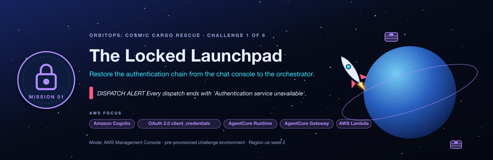
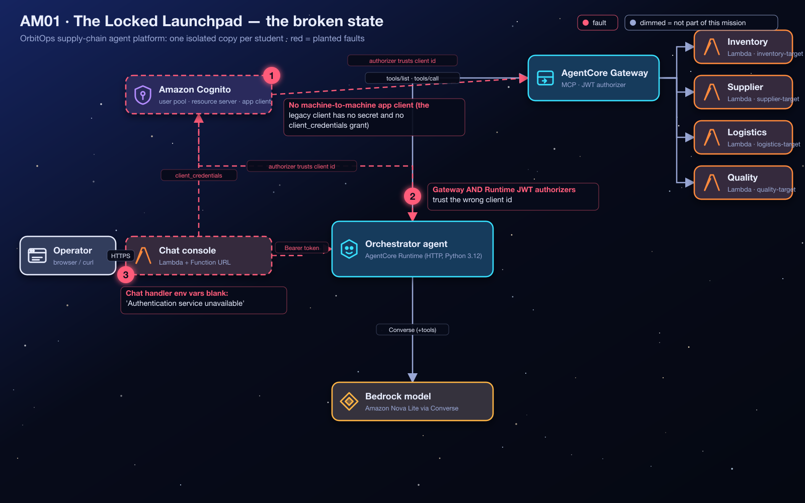
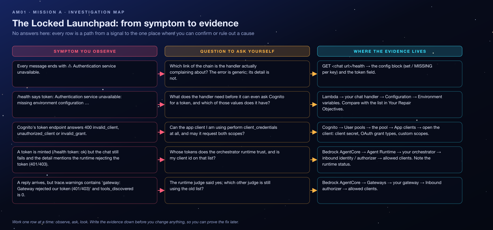

<sub>[⬅ All missions](../README.md) · [AM02 The Case of the Misrouted Cargo Droids ➡](../AM02-gateway-tool-routing/README.md)</sub>

<p align="center"></p>

# AM01 — Mission A: The Locked Launchpad — Student Handout

**OrbitOps: Cosmic Cargo Rescue** · Challenge A of 6
**AWS focus:** Amazon Cognito, OAuth 2.0 (`client_credentials`), Amazon Bedrock AgentCore Runtime and Gateway (JWT authorizers), AWS Lambda
**Mode:** AWS Management Console (CLI optional) · pre-provisioned challenge environment · **Region `us-west-2`**

> [!IMPORTANT]
> All lab resources live in **US West (Oregon) — `us-west-2`**. Before you open the console or run a CLI command, confirm the region. Every resource you own is prefixed with your student id, for example `orbit-student07-am01-…`. Touch only resources with your prefix.

> [!WARNING]
> **Dispatch alert:** Cargo ships are ready to launch, but the OrbitOps chat console can't reach its AI flight controller. Every attempt ends with **"Authentication service unavailable."** Someone changed the identity setup during a migration, and the automated dispatch desk is grounded.

## Lab Goals

- Repair a **machine-to-machine (M2M) OAuth 2.0 chain**: a confidential Cognito app client, the `client_credentials` grant, and resource-server scopes.
- Understand how **AgentCore JWT authorizers** decide whether to trust a token (`discoveryUrl` + `allowedClients`), on both a **Gateway** and a **Runtime**.
- Finish the wiring by giving the **chat handler Lambda** the configuration it needs to mint a token and call the orchestrator.

## The Situation

OrbitOps runs a supply-chain application with a chat console and an orchestrator agent hosted in **AgentCore Runtime**. The console's Lambda is supposed to obtain an access token from Amazon Cognito and present it as a bearer token to the orchestrator. The orchestrator forwards that same token to the **AgentCore Gateway** when it needs tools.

After the migration, the only app client in the user pool is a *public web client*: it has **no client secret** and **no `client_credentials` grant**, so no server-side component can authenticate with it. Both AgentCore authorizers still point at that unusable client, and the chat handler's configuration was wiped.

You are repairing the deployed system, not building a new one.

## Architecture

<p align="center"></p>

The token's journey, in words: **browser → chat handler (Function URL) → Cognito `/oauth2/token` → AgentCore Runtime (bearer token) → AgentCore Gateway (same token, forwarded)**. Every hop that validates the token asks Cognito's **OIDC discovery document** for the signing keys and then checks the token's `client_id` claim against its **allowed clients** list.

## What Is Already In Place

Your instructor gives you these values (from `terraform output`) for **your** student id:

| Value | Where you'll use it |
|---|---|
| `chat_urls[<you>]` | The OrbitOps chat console. `GET /health` on the same URL shows which settings are missing. |
| `cognito_user_pool_id` | The shared user pool with resource server `supplychain` and scopes `supplychain/read`, `supplychain/write`. |
| `cognito_domain` | The pool's hosted domain. The token endpoint is `https://<domain>/oauth2/token`. |
| `cognito_discovery_url` | The OIDC discovery URL every JWT authorizer uses. |
| `legacy_client_ids[<you>]` | The unusable app client the authorizers currently trust. |
| `gateway_ids[<you>]`, `gateway_urls[<you>]` | Your AgentCore Gateway (JWT authorizer, `READY`). |
| `orchestrator_runtime_ids[<you>]`, `orchestrator_runtime_arns[<you>]` | Your orchestrator AgentCore Runtime (JWT authorizer, `READY`). |
| `chat_function_names[<you>]` | Your chat handler Lambda. |

## Starting Symptoms

1. Open your chat URL and send *"Flight control, are you receiving my cargo dispatch requests?"* → the console shows **⚠ Authentication service unavailable**.
2. `GET <chat url>/health` lists several configuration values as **MISSING**.
3. In Cognito, the pool has one app client per student named `…-web-client-legacy`. It shows **no client secret**.

## Time Limit

**40 minutes.**

## Your Repair Objectives

- [ ] Create an **Amazon Cognito machine-to-machine app client** that can use the **`client_credentials`** OAuth 2.0 grant. It must have a **client secret**; this is a confidential, server-side client. Give it a unique name containing your student id.
- [ ] Authorize the existing resource-server scopes **`supplychain/read`** and **`supplychain/write`** on that client.
- [ ] Update the JWT authorizer **allowed clients** on **both** your AgentCore **Gateway** and your orchestrator **Runtime** so they trust the new client id.
- [ ] Repair the **chat handler Lambda** environment configuration:

  ```text
  ORCHESTRATOR_RUNTIME_ARN
  COGNITO_DOMAIN
  COGNITO_CLIENT_ID
  COGNITO_CLIENT_SECRET
  COGNITO_USER_POOL_ID
  ```

Use the identifiers and endpoint values of the **existing** resources. Do not create a new pool, gateway, or runtime, and do not change the scope names.

## Concept Briefing (read this before you click anything)

- **`client_credentials` grant.** The OAuth 2.0 flow for software talking to software. There is no user: the client proves *its own* identity with a client id + client secret and receives an **access token** scoped to resource-server scopes. Cognito only allows this grant on an app client that has a secret.
- **Resource server and scopes.** The resource server `supplychain` defines custom scopes. A client may only request scopes it has been *allowed*. The resulting token carries them in its `scope` claim.
- **JWT authorizer (AgentCore).** Both Gateway and Runtime can validate inbound bearer tokens themselves. They fetch the issuer's keys from the **discovery URL** and accept a token only if its `client_id` (or audience) matches **allowedClients** (or **allowedAudience**). A token from a client that is not listed is rejected with **401/403**, even if Cognito issued it.
- **Token pass-through.** The orchestrator runtime is configured to forward the inbound `Authorization` header to the agent code, which reuses the same token for the Gateway. One trusted client id therefore has to be known to **both** authorizers.

## Investigation Map

Before touching anything, read the map: every row is a path from a signal you can observe to the one place where you can confirm or rule out a cause. It contains no answers, only places to look.

<p align="center"></p>

## Guided Investigation Hints

> [!TIP]
> **How to use the hints.** Collect the evidence in the checklist first. Then open hints top-down, one objective at a time, and **stop reading the moment you get an idea** so you can go test it. Each objective has three levels: *Where to look* → *What to compare* → *The nudge*. Level 3 never states the answer, but it leaves you one short step away.

### Evidence to collect before opening any hint

- [ ] The exact text of the error in the chat console, **and** the `detail` field under it (expand the trace).
- [ ] The full JSON from `GET <chat url>/health`: which keys are `MISSING`, what the `token` field says, and what `cognito_discovery` reports.
- [ ] The list of app clients in your pool, and for your legacy client: *client secret?* *OAuth grant types?* *custom scopes?*
- [ ] For both your gateway and your runtime: the **allowed clients** currently listed (write them down; you will compare them later).

### Hint ladder — Objective 1 · the app client

<details><summary><b>Level 1 · Where to look</b></summary>

Cognito → User pools → the lab pool → **App clients**. Open the legacy client and read its *App client information* and its OAuth settings. Note two things that are absent. Then look at what the **Create app client** button asks you first.
</details>

<details><summary><b>Level 2 · What to compare</b></summary>

Compare what the chat handler *needs* to mint a token (look at the five variable names: one of them is a secret) with what the legacy client *has*. A client with nothing secret about it cannot prove who it is. Ask yourself which **kind** of application proves its identity without a human signing in.
</details>

<details><summary><b>Level 3 · The nudge</b></summary>

The create wizard's first choice is the *application type*. One of the options is named for software that talks to other software, and choosing it changes the rest of the form: a secret is generated automatically. The wizard does **not** ask which scopes to allow: it grants a default scope of its own. So after you create, open the client's **Login pages** tab and check its **custom scopes** against the two the chat handler requests. Copy the two values the chat handler will need.
</details>

### Hint ladder — Objective 2 · the two authorizers

<details><summary><b>Level 1 · Where to look</b></summary>

Two places, not one: Bedrock AgentCore → **Gateways** → your gateway → **Inbound Auth** panel; and Bedrock AgentCore → **Runtime** → your orchestrator → the inbound identity / OAuth section of its hosting configuration. Each has its own **allowed clients** list.
</details>

<details><summary><b>Level 2 · What to compare</b></summary>

Compare the client id you just created with the id(s) in each allowed-clients list. Then compare the error you get from the console with the two possible verdicts: the *chat handler* complains when the **runtime** refuses; the *orchestrator's trace warnings* complain when the **gateway** refuses. Which judge is saying no right now?
</details>

<details><summary><b>Level 3 · The nudge</b></summary>

Leave the discovery URL alone; only the list is wrong. After you edit the runtime, its status leaves `READY` for a minute while a new version is published; the old version keeps answering until then. If one judge is fixed and the other is not, the symptoms are *different* from the starting state. Read them again before assuming your edit "did nothing".
</details>

### Hint ladder — Objective 3 · the chat handler configuration

<details><summary><b>Level 1 · Where to look</b></summary>

Lambda → your chat handler → **Configuration → Environment variables**. `/health` tells you which keys are empty; your outputs tell you where most of the values come from.
</details>

<details><summary><b>Level 2 · What to compare</b></summary>

Two values look alike and get swapped: the **user pool id** (starts with `us-west-2_`) and the **domain** (a host name ending in `amazoncognito.com`). Compare each variable name with the shape of the value you are about to paste. Ask: does the code add `https://` itself?
</details>

<details><summary><b>Level 3 · The nudge</b></summary>

`/health` is more than a checklist: once the five values are set it also *tries to mint a token* and reports the result. If `token` is not `ok`, its message quotes Cognito's own error (`invalid_client`, `invalid_grant`, …), which points you straight back to Objective 1. Keep `STUDENT_ID` and `MODULE` when you save.
</details>

### Stuck? Symptom decision tree

```text
Is /health showing any key as MISSING?
├─ yes → Objective 3 first. Nothing downstream can be tested yet.
└─ no  → Does /health say token: ok?
         ├─ no  → read the quoted Cognito error:
         │        invalid_client / unauthorized_client → Objective 1 (secret? grant?)
         │        invalid_grant                        → Objective 1 (scopes allowed?)
         │        could not reach … /oauth2/token      → Objective 3 (COGNITO_DOMAIN shape)
         └─ yes → Send a chat message. What comes back?
                  ├─ "runtime rejected the token (401/403)"        → Objective 2, the RUNTIME judge
                  ├─ a reply, but warnings mention gateway 401/403 → Objective 2, the GATEWAY judge
                  ├─ a reply, tools_discovered > 0, warnings []     → Flight Test. You are done.
                  └─ HTTP 424 / "Flight controller fault"           → not this lab's fault; check the
                                                                       runtime's CloudWatch logs
```

### Self-check before you call the instructor

- [ ] Does my new client show a **client secret** and the **`client_credentials`** grant on its page?
- [ ] Are **both** custom scopes listed as allowed on the client?
- [ ] Is the new client id present in **both** allowed-clients lists (gateway **and** runtime)?
- [ ] Is the runtime status back to `READY` since my last edit?
- [ ] Does `COGNITO_DOMAIN` contain no `https://` and no path, and does `COGNITO_USER_POOL_ID` start with `us-west-2_`?
- [ ] Did I re-test after fixing Cognito? (Failed token requests are never cached; the very next message uses the fix.)

### Red herrings (don't go down these holes)

- **The discovery URL.** It is correct on both authorizers. Changing it creates new problems.
- **The scope names.** `supplychain/read` and `supplychain/write` exist; do not create a new resource server.
- **Creating a new gateway or runtime.** The existing ones are healthy; only their trust lists are wrong.
- **The legacy client.** You cannot "upgrade" it; leave it alone (or ignore it) and build the right kind of client.
- **Runtime 424 errors.** Those mean the agent code crashed, which is not something this mission planted.

### What a good hypothesis sounds like

> *"Because `/health` says `token: ok` but the chat still fails with a 403 from the runtime, I expect the runtime's allowed clients to still contain only the legacy id. Test: open the runtime's inbound identity settings and compare the list with my new client id."*

State the evidence, the expectation, and the one test that would prove you wrong. Then run the test.

## Debugging Playbook (How a Pro Thinks)

| Signal | Layer | First move |
|---|---|---|
| `Authentication service unavailable` + `/health` shows `MISSING` | Configuration | Fill the env vars; nothing downstream can be tested yet |
| Cognito token endpoint returns `400 invalid_client` / `unauthorized_client` | App client | Secret present? `client_credentials` enabled? Scopes allowed? |
| Token minted, runtime answers **401/403** | Runtime authorizer | Is this `client_id` in the runtime's allowed clients? |
| Runtime answers, but the trace says `Gateway rejected our token (401/403)` | Gateway authorizer | Same check on the Gateway |

Mental model: a bearer token is **evidence**, and every hop is a **separate judge**. Each judge has its own list of who it trusts. Fixing one judge does not fix the next one.

## Things to Check

- **Cognito → User pools → your pool → App clients:** client secret, OAuth grant types, custom scopes.
- **Cognito → Branding / Domain:** the hosted domain prefix.
- **Bedrock AgentCore → Gateways → your gateway → Inbound Auth:** allowed clients.
- **Bedrock AgentCore → Runtime → your agent → (Update runtime / Inbound identity):** allowed clients; status returns to `READY`.
- **Lambda → your chat handler → Configuration → Environment variables.**
- **Chat console → the "trace" panel under each reply:** `token_source`, `tools_discovered`, `warnings`.

## Flight Test

1. Open your chat console URL. The header shows your student id.
2. Ask: **"Flight control, are you receiving my cargo dispatch requests?"**
3. Expect a reply from the orchestrator (not an error). Expand the **trace**: `token_source: inbound` and `tools_discovered` greater than 0, with an empty `warnings` list.
4. Ask **"Check our cargo stock levels"** to confirm the forwarded token is also accepted by the Gateway.

**Mission accomplished when:** a chat message travels through the application and receives a reply from the orchestrator runtime, with no authentication warnings in the trace.

> [!NOTE]
> **Mission control note:** Keep the client secret out of browser code, screenshots and shared documents. Several people share this account: use a unique client name and edit **only your own** gateway and runtime.

## Key Takeaways

- **`client_credentials` needs a confidential client.** No secret, no M2M grant. Cognito's "machine-to-machine" app type sets this up correctly.
- **Scopes are allow-listed per client.** A client can only request the resource-server scopes it was granted.
- **JWT authorizers trust client ids, not pools.** Creating a new client means updating `allowedClients` on *every* AgentCore resource that validates the token.
- **Configuration is part of the auth chain.** A perfect identity setup still fails if the caller does not know the domain, client id, secret, or runtime ARN.

## Reflection Questions

1. Why does the chat handler mint the token server-side instead of letting the browser call Cognito?
2. If only the Gateway's allowed clients were updated, where exactly would the chain break, and what would the trace show?
3. What would change if the authorizers used `allowedAudience` instead of `allowedClients`? Why does a Cognito M2M access token not carry an `aud` claim?

**Coming next:** The flight controller can talk, but its cargo-handling tools are miswired.

---

> [!NOTE]
> **Finished, or out of time?** Your instructor walks through the fix live and then shares the **debrief guide** for this mission: the root causes, every console step with screenshots, the exam angle and model answers to the reflection questions. Try the hint ladder first: the struggle is where the learning happens.

<sub>[⬅ All missions](../README.md) · [AM02 The Case of the Misrouted Cargo Droids ➡](../AM02-gateway-tool-routing/README.md)</sub>
