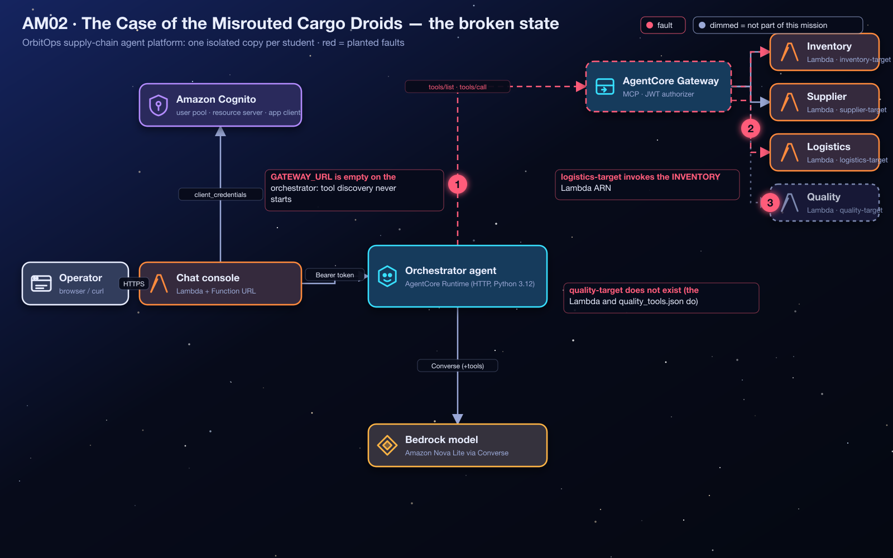
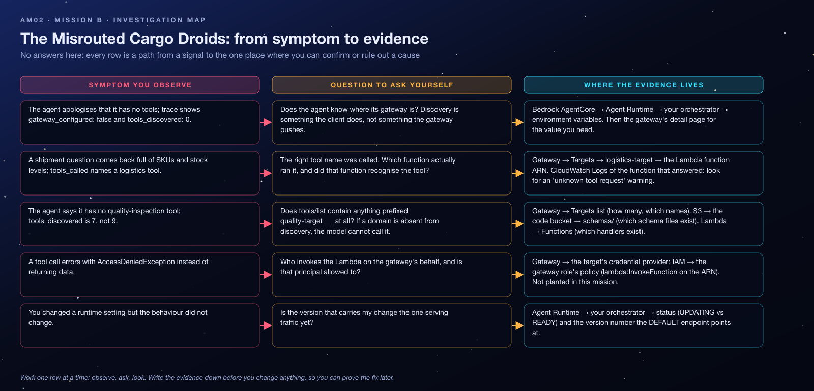

<sub>[⬅ All missions](../README.md) · [⬅ AM01 The Locked Launchpad](../AM01-cognito-oauth-launchpad/README.md) · [AM03 The Vanishing Starport Manuals ➡](../AM03-knowledge-base-specialist/README.md)</sub>

<p align="center"></p>

# AM02 — Mission B: The Case of the Misrouted Cargo Droids — Student Handout

**OrbitOps: Cosmic Cargo Rescue** · Challenge B of 6
**AWS focus:** Amazon Bedrock AgentCore Gateway, Model Context Protocol (MCP) tools, AWS Lambda targets, Amazon S3 tool schemas
**Mode:** AWS Management Console (CLI optional) · pre-provisioned challenge environment · **Region `us-west-2`**

> [!IMPORTANT]
> Work only on resources prefixed with **your** student id (`orbit-<you>-am02-…`). Gateway targets are **not** safely duplicated by giving each person a different target name: every student has their own gateway for exactly that reason.

> [!WARNING]
> **Dispatch alert:** The OrbitOps flight controller can chat about the weather on Mars, but ask it where a shipment went and it returns *inventory counts*. Request a quality inspection and the tool doesn't even exist. The droids have mixed up their assignments.

## Lab Goals

- Understand how an agent **discovers tools** through an AgentCore Gateway using MCP (`tools/list`, `tools/call`) and why the agent must be told the gateway's URL.
- Read a **gateway target** configuration critically: the Lambda ARN it invokes, the **tool schema** that describes its tools, and the credential provider it uses.
- Create a missing **Lambda target** from a schema stored in Amazon S3.

## The Situation

The orchestrator is meant to discover supply-chain tools through its **AgentCore Gateway**. Three faults interrupt that process:

1. The orchestrator runtime's **`GATEWAY_URL`** environment variable is empty, so tool discovery never starts.
2. The gateway's **logistics target** invokes the **inventory Lambda**, not the logistics Lambda.
3. The **quality target** is missing, so quality tools are unavailable.

Restore the four-domain tool system — **inventory, supplier, logistics, quality** — without changing the application architecture.

## Architecture

<p align="center"></p>

Tool names seen by the model are **`<target name>___<tool name>`** (three underscores), for example `logistics-target___track_shipment`. The gateway invokes the target's Lambda with the tool arguments as the event and puts the full tool name in the Lambda **context** (`bedrockAgentCoreToolName`). Each Lambda strips the prefix and dispatches on the bare tool name.

## What Is Already In Place

| Value | Notes |
|---|---|
| `chat_urls[<you>]` | Chat console; the **trace** panel shows `tools_discovered`, `tools_called` and `warnings`. |
| `gateway_ids[<you>]`, `gateway_urls[<you>]` | Your gateway, `READY`, with a working JWT authorizer. Its MCP endpoint is the URL. |
| Targets `inventory-target`, `supplier-target`, `logistics-target` | Exist on your gateway (logistics is miswired). |
| `tool_function_arns[<you>-inventory]`, `…-supplier`, `…-logistics`, `…-quality` | Four deployed Lambda handlers. |
| `quality_schema_s3_uri` | `s3://<code bucket>/schemas/quality_tools.json`, the schema for the quality tools. The other three schemas sit next to it. |
| `orchestrator_runtime_ids[<you>]` | Your orchestrator runtime (its env vars are where `GATEWAY_URL` lives). |
| Working authentication from Mission A | The M2M client, authorizers and chat handler are already correct. |

## Starting Symptoms

1. *"Check our cargo stock levels"* → the agent apologizes that it has **no tools connected**; trace: `gateway_configured: false`, `tools_discovered: 0`.
2. After `GATEWAY_URL` is fixed: *"Where is shipment SHP-1001?"* → an answer full of **stock levels and SKUs** instead of a position and ETA.
3. *"Show the status of cargo quality inspections"* → the agent says it has **no quality-inspection tool**.

## Time Limit

**40 minutes.**

## Your Repair Objectives

- [ ] Set the orchestrator agent runtime environment variable **`GATEWAY_URL`** to the **existing AgentCore Gateway endpoint URL**.
- [ ] Inspect the **logistics target** and replace its incorrect Lambda ARN with the ARN of the **logistics handler**.
- [ ] Create the missing gateway target for quality inspections, using:
  - the required target name **`quality-target`**;
  - the **quality Lambda** function ARN;
  - the **`quality_tools.json`** schema stored in Amazon S3;
  - the **Gateway IAM role** credential provider (the gateway's own role).
- [ ] Keep the existing logistics target name as **`logistics-target`**.
- [ ] Confirm the orchestrator can discover and invoke tools for **all four domains**.

**Do not rename** the specified targets. Their names are part of the integration contract (they prefix every tool name).

## Concept Briefing

- **MCP through a Gateway.** The gateway is an MCP server. A client sends JSON-RPC `initialize`, then `tools/list` to discover tools and `tools/call` to run one. The orchestrator does this at the start of every turn, *if* it knows the gateway URL.
- **Targets.** A target maps a backend (Lambda, OpenAPI, Smithy, another MCP server) onto tools. For a Lambda target you give a **tool schema** (name, description, `inputSchema`) inline or as an **S3 object**, and a **credential provider** that says how the gateway authenticates to the backend (`GATEWAY_IAM_ROLE` for Lambda).
- **Why the misroute "works".** The gateway happily invokes whatever ARN the target names. The inventory Lambda receives `logistics-target___track_shipment`, does not know it, and falls back to its stock summary. Nothing errors; the data is simply wrong. Schema correct + ARN wrong is a classic silent fault.
- **Environment variables on a runtime.** Changing them creates a new runtime **version**; the `DEFAULT` endpoint follows the latest version once it is `READY`.

## Investigation Map

Before touching anything, read the map: every row is a path from a signal you can observe to the one place where you can confirm or rule out a cause. It contains no answers, only places to look.

<p align="center"></p>

## Guided Investigation Hints

> [!TIP]
> **How to use the hints.** Collect the evidence in the checklist first. Then open hints top-down, one objective at a time, and **stop reading the moment you get an idea** so you can go test it. Each objective has three levels: *Where to look* → *What to compare* → *The nudge*. Level 3 never states the answer, but it leaves you one short step away.

### Evidence to collect before opening any hint

- [ ] The trace of one failed request: `gateway_configured`, `tools_discovered`, `tools_called` (tool names **and** `result_preview`), `warnings`.
- [ ] The **Targets** table of your gateway: every target's name, Lambda ARN and schema source, written down side by side.
- [ ] The list of your four tool Lambda functions (names and ARNs) from `tool_function_arns` or the Lambda console.
- [ ] The contents of `schemas/` in the code bucket (four files; open `quality_tools.json` and note its two tool names).

### Hint ladder — Objective 1 · tool discovery

<details><summary><b>Level 1 · Where to look</b></summary>

`gateway_configured: false` is reported by the *orchestrator*, not by the gateway. Open Bedrock AgentCore → **Runtime** → your orchestrator and read its environment variables. One of them is empty.
</details>

<details><summary><b>Level 2 · What to compare</b></summary>

Compare the *shape* of what that variable needs (a URL the MCP client can POST to) with what the gateway's detail page offers: an ARN, an id, and an endpoint URL. Only one of those three is something a client can send JSON-RPC to.
</details>

<details><summary><b>Level 3 · The nudge</b></summary>

The value ends in `/mcp` and contains your gateway id and the words `gateway.bedrock-agentcore`. Editing a runtime's environment variables publishes a new **version**; test only after the status returns to `READY`, or the old version will keep telling you it has no gateway. Expect `tools_discovered` to become **7**, not 9, until a later objective is done.
</details>

### Hint ladder — Objective 2 · the misrouted logistics tool

<details><summary><b>Level 1 · Where to look</b></summary>

Ask *"Where is shipment SHP-1001?"* and expand the trace. The tool name in `tools_called` is right. Now read `result_preview`: which **service** says it answered? Then open Gateway → **Targets** → `logistics-target` and read, character by character, the Lambda ARN it invokes.
</details>

<details><summary><b>Level 2 · What to compare</b></summary>

Compare the *last word* of that ARN with the *first word* of the target's name. Then compare with the other targets: does each name match its function? A target is just a binding between a schema and a function; the name proves nothing.
</details>

<details><summary><b>Level 3 · The nudge</b></summary>

CloudWatch Logs for the function that *actually* ran contain a warning line naming the tool it did not recognise. That line is your evidence. The fix is an **Edit** of the existing target (not a new one): change only the function, keep the name and the schema, and ask the shipment question again. The reply should now contain a position and an ETA.
</details>

### Hint ladder — Objective 3 · the missing quality tools

<details><summary><b>Level 1 · Where to look</b></summary>

Count the targets on your gateway and count the schema files in S3 and the tool Lambdas. Three numbers; two of them agree. The model cannot call a tool that was never listed by `tools/list`.
</details>

<details><summary><b>Level 2 · What to compare</b></summary>

Open an existing target and note the four things it is made of: a name, a function ARN, a tool schema (where does it come from?), and a credential provider. The quality target needs the same four, and three of them already exist in your outputs or in S3. Compare the required name in Your Repair Objectives with how the other targets are named.
</details>

<details><summary><b>Level 3 · The nudge</b></summary>

In **Add target**, choose the Lambda type, pick the quality function, point the schema at the **S3 URI** from `quality_schema_s3_uri` (do not retype JSON), and select the gateway's own IAM role as the credential provider. New targets take a minute to become `READY`; the orchestrator's tool cache refreshes within another minute. Then `tools_discovered` should read **9**.
</details>

### Stuck? Symptom decision tree

```text
Does the trace say gateway_configured: false?
├─ yes → Objective 1. (A gateway that is READY is irrelevant until the client knows its URL.)
└─ no  → Is tools_discovered 0 with a warning mentioning the gateway?
         ├─ 401/403 in the warning → not this mission; Mission A's trust lists (allowed clients)
         ├─ an HTTP error / bad URL → Objective 1 again: the URL's shape is wrong
         └─ no warning → How many tools were discovered?
                  ├─ 7 → Objective 3 (one domain is not registered)
                  └─ 9 → Ask the shipment question. Does result_preview say "service": "logistics"?
                         ├─ no, it says inventory → Objective 2
                         └─ yes → Flight Test all four domains. You are done.
```

### Self-check before you call the instructor

- [ ] Does `GATEWAY_URL` end in `/mcp` and start with `https://`?
- [ ] Is the orchestrator runtime back to `READY` since the edit?
- [ ] Does `logistics-target` now invoke a function whose name ends in `-logistics`, with its name and schema unchanged?
- [ ] Is the new target named exactly `quality-target`, status `READY`, schema from S3, credential provider = gateway IAM role?
- [ ] Does the trace show `tools_discovered: 9`?
- [ ] Did I test each domain with ids that exist (`SHP-1001…1004`, `INS-501…504`, SKUs like `ION-COIL-7`)?

### Red herrings (don't go down these holes)

- **The gateway's authorizer.** Authentication works in this mission; a 403 would be Mission A's problem, and it is not planted here.
- **The Lambda code.** All four handlers are correct. If a Lambda "answers wrongly", ask which Lambda was invoked, not what it computed.
- **Inline schemas.** Retyping JSON invites typos; the S3 objects are already right.
- **Renaming targets to "fix" them.** Names are the contract; renaming breaks every tool name.
- **Creating a new gateway.** The existing one is healthy; its targets are the problem.

### What a good hypothesis sounds like

> *"Because the shipment question called `logistics-target___track_shipment` but `result_preview` says `service: inventory`, I expect the logistics target's Lambda ARN to end in `-inventory`. Test: open the target and read the ARN; confirm with the inventory function's CloudWatch log."*

State the evidence, the expectation, and the one test that would prove you wrong. Then run the test.

## Debugging Playbook (How a Pro Thinks)

| Signal | Layer | First move |
|---|---|---|
| `tools_discovered: 0`, `gateway_configured: false` | Agent configuration | Set `GATEWAY_URL`; wait for runtime `READY` |
| `warnings: ["gateway: … 403"]` | Gateway authorizer | Mission A's checks (not planted here) |
| Right tool name called, wrong *kind* of data back | Target wiring | Compare target Lambda ARN with the function it should hit |
| Model says a capability is "not connected" while others work | Missing target | `tools/list` has no tool for that domain |

Mental model: **discovery → routing → execution** are three separate contracts. The URL governs discovery, the target's ARN governs routing, the Lambda's code governs execution. Check them in that order.

## Things to Check

- **Bedrock AgentCore → Runtime → your agent → environment variables:** `GATEWAY_URL`.
- **Bedrock AgentCore → Gateways → your gateway:** MCP endpoint URL; **Targets** tab: names, Lambda ARNs, schema sources.
- **Lambda → `orbit-<you>-am02-logistics` / `-quality`:** copy ARNs from here.
- **Amazon S3 → the code bucket → `schemas/`:** the four schema files (read `quality_tools.json` to learn the tool names).
- **CloudWatch Logs → `/aws/lambda/orbit-<you>-am02-inventory`:** the `warning: … unknown tool request 'track_shipment'` line is the smoking gun for the misroute.

## Flight Test

Try four distinct chat requests:

| Domain | Sample dispatch request | What to look for |
|---|---|---|
| Inventory | "Check our cargo stock levels." | SKUs, on-hand quantities, low-stock items |
| Supplier | "Who supplies NAV-GYRO-X and what is their lead time?" | Titan Dynamics, 45 days |
| Logistics | "Where is shipment SHP-1001?" | Position, status, ETA — **not** an inventory report |
| Quality | "Show the status of cargo quality inspections." | Inspection ids and results, no missing-tool failure |

The Lambda handlers define which ids exist (`SHP-1001…1004`, `INS-501…504`, SKUs like `ION-COIL-7`). Use the schema descriptions and test data rather than inventing ids.

**Mission accomplished when:** tool discovery works and the orchestrator executes **inventory, supplier, logistics and quality** operations through the Gateway (trace: `tools_discovered: 9`, and `tools_called` shows a tool from each domain across your tests).

> [!NOTE]
> **Mission control note:** Changing a runtime's environment variables publishes a new version; give it a minute. In a shared account, coordinate any edits to targets: they belong to *your* gateway only.

## Key Takeaways

- **An agent only knows the tools it can discover.** No gateway URL, no `tools/list`, no tools.
- **Target name ≠ target wiring.** The Lambda ARN is the routing; the name is just a prefix on the tool names.
- **Schemas describe, they don't route.** A perfect schema on the wrong ARN produces confident, wrong answers.
- **Lambda targets use the gateway's IAM role** as their credential provider, and that role must be allowed to invoke the function.

## Reflection Questions

1. Why did the misrouted logistics call return *inventory data* instead of an error? What would you change in the Lambda to make the fault loud?
2. How could the gateway's `tools/list` output alone have revealed fault 3 before you ever chatted?
3. If a target's schema in S3 is edited, does the gateway pick it up automatically? What has to happen?

**Coming next:** The tools work, but the agent still cannot consult its cargo operations manuals.

---

> [!NOTE]
> **Finished, or out of time?** Your instructor walks through the fix live and then shares the **debrief guide** for this mission: the root causes, every console step with screenshots, the exam angle and model answers to the reflection questions. Try the hint ladder first: the struggle is where the learning happens.

<sub>[⬅ All missions](../README.md) · [⬅ AM01 The Locked Launchpad](../AM01-cognito-oauth-launchpad/README.md) · [AM03 The Vanishing Starport Manuals ➡](../AM03-knowledge-base-specialist/README.md)</sub>
