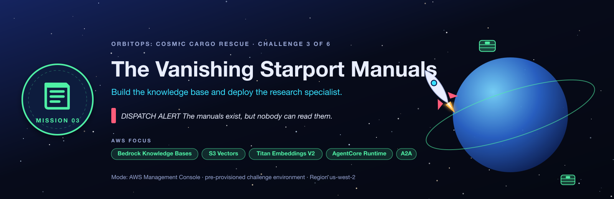
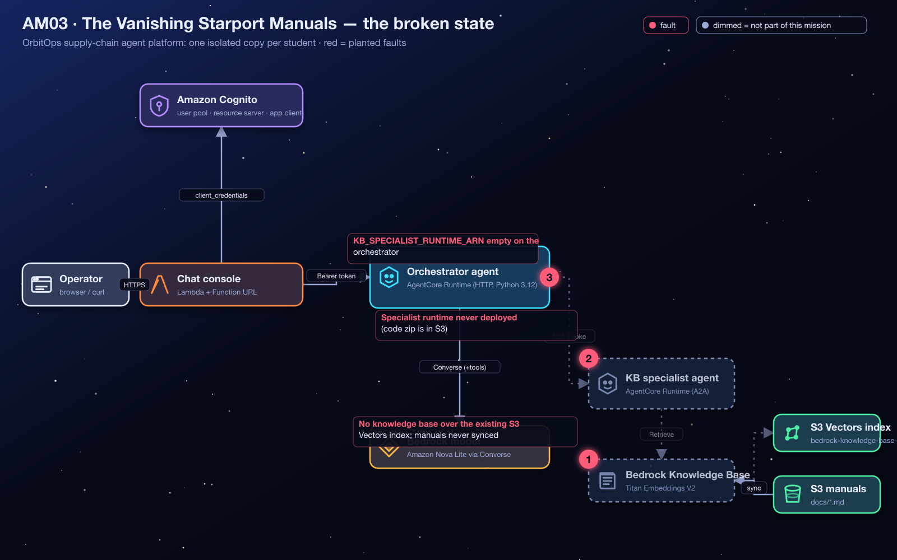
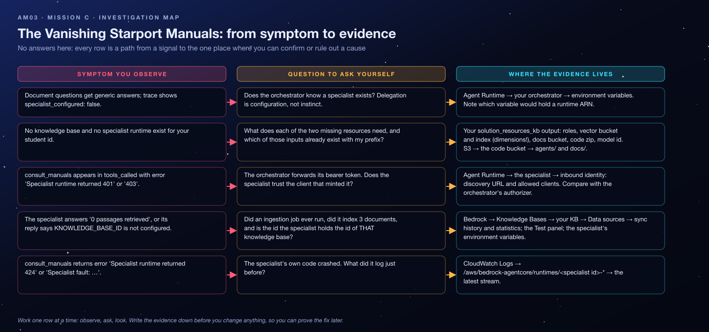

<sub>[⬅ All missions](../README.md) · [⬅ AM02 The Case of the Misrouted Cargo Droids](../AM02-gateway-tool-routing/README.md) · [AM04 The Forgetful Flight Computer ➡](../AM04-agentcore-memory/README.md)</sub>

<p align="center"></p>

# AM03 — Mission C: The Vanishing Starport Manuals — Student Handout

**OrbitOps: Cosmic Cargo Rescue** · Challenge C of 6
**AWS focus:** Amazon Bedrock Knowledge Bases, Amazon S3 Vectors, Titan Text Embeddings V2, Amazon S3, AgentCore Runtime (direct code deployment), agent-to-agent (A2A) delegation
**Mode:** AWS Management Console (CLI optional) · pre-provisioned challenge environment · **Region `us-west-2`**

> [!IMPORTANT]
> Work only on resources prefixed with **your** student id. Give every resource you create a unique name containing your id. The vector store, roles and code package were pre-provisioned for you; **reuse them**, don't recreate them.

> [!WARNING]
> **Dispatch alert:** OrbitOps has inventory procedures, a supplier manual and a quality-control manual, but the flight controller can't answer questions from them. Its specialist research droid was never deployed, and its searchable document library was never connected.

## Lab Goals

- Build a **Bedrock Knowledge Base** on top of an *existing* vector store (**Amazon S3 Vectors**, the low-cost stand-in for the micro-credential's OpenSearch Serverless collection), matching the index's embedding dimensions.
- Attach an **S3 data source** and **sync** it, and understand why "created" is not "ingested".
- Deploy a second agent to **AgentCore Runtime** from a code package in S3, with a **JWT authorizer**, an execution role and environment variables.
- Wire **agent-to-agent delegation**: the orchestrator hands document questions to the specialist.

## The Situation

The orchestrator is designed to hand off document questions to a **knowledge-base specialist** agent. The specialist's code and most of the infrastructure are ready, but **neither the Bedrock knowledge base nor the specialist AgentCore runtime exists**, and the orchestrator does not know where to send document questions. Complete the retrieval path so answers come from the provided documents instead of guesswork.

## Architecture

<p align="center"></p>

Retrieval path: **orchestrator → (A2A, bearer token) specialist runtime → `Retrieve` on the knowledge base → S3 Vectors index ← ingestion from the S3 manuals**.

## What Is Already In Place

Confirm these before starting. They are in your `solution_resources_kb[<you>]` output:

| Key | What it is |
|---|---|
| `KnowledgeBaseBucketName` + `KnowledgeBaseDocsPrefix` | The S3 bucket and `docs/` prefix holding **inventory-procedures.md**, **supplier-manual.md**, **quality-control-manual.md** |
| `VectorBucketName`, `VectorBucketArn` | Your **S3 Vectors** vector bucket |
| `VectorIndexName` = `bedrock-knowledge-base-index`, `VectorIndexArn` | The vector index: **1024 dimensions, float32, cosine**, with `AMAZON_BEDROCK_TEXT` and `AMAZON_BEDROCK_METADATA` non-filterable |
| `EmbeddingModelId` = `amazon.titan-embed-text-v2:0`, `EmbeddingDimensions` = `1024` | The embedding model and dimensions the index was built for |
| `KnowledgeBaseRoleArn` | IAM role for the knowledge base (can call Titan, read the manuals, read/write the index) |
| `KBSpecialistRoleArn` | IAM execution role for the specialist runtime |
| `KBSpecialistAgentCodeS3Uri` | `s3://<bucket>/agents/kb_specialist.zip`, the specialist's code package (entry point `main.py`) |
| `KBSpecialistModelId` | Model id for the specialist's `MODEL_ID` |

Plus, from Mission A: `cognito_discovery_url` and `m2m_client_ids[<you>]`, and `orchestrator_runtime_ids[<you>]`.

## Starting Symptoms

1. *"What do our cargo handling procedures say about inventory checks?"* → the agent answers from general knowledge or says it has no manuals; trace: `specialist_configured: false`.
2. Bedrock → Knowledge Bases shows no knowledge base for your student id.
3. AgentCore → Runtime shows only your orchestrator.

## Time Limit

**60 minutes.**

## Your Repair Objectives

- [ ] Create an **Amazon Bedrock knowledge base** backed by the **existing S3 Vectors vector bucket and index**. Use the embedding model **`amazon.titan-embed-text-v2:0`** with **1024** dimensions (float32) so it matches the index. Use the provided **`KnowledgeBaseRoleArn`**; do not create a new index.
- [ ] Attach the supplied S3 bucket (prefix `docs/`) as the knowledge base **data source**, then **sync** it so the manuals are ingested.
- [ ] Deploy an **AgentCore specialist runtime** from the provided S3 code package with:

  | Setting | Required value |
  |---|---|
  | Code source | `KBSpecialistAgentCodeS3Uri` |
  | Entry point | `main.py` |
  | Python runtime | `PYTHON_3_12` |
  | Protocol | `HTTP` |
  | Network | `PUBLIC` |
  | Execution role | `KBSpecialistRoleArn` |
  | Inbound authorizer | `CUSTOM_JWT`, discovery URL = `cognito_discovery_url`, allowed client = `m2m_client_ids[<you>]` |

- [ ] Give the specialist runtime a name containing **`kb`**, **`specialist`** or **`knowledge`** (for example `student07_kb_specialist`; runtime names allow letters, digits and underscores only).
- [ ] Configure these specialist runtime environment variables:

  ```text
  MODEL_ID=<value from KBSpecialistModelId>
  KNOWLEDGE_BASE_ID=<ID of your new knowledge base>
  ```

- [ ] Confirm the runtime's **`DEFAULT` endpoint** exists and is `READY`.
- [ ] Set **`KB_SPECIALIST_RUNTIME_ARN`** on the **orchestrator** runtime to the specialist runtime ARN.

## Concept Briefing

- **Knowledge base = embeddings + vector store + data source.** Documents are chunked, embedded by the embedding model, and written to the vector index. At query time the question is embedded and the nearest chunks are returned (`Retrieve`). The **dimensions of the index and of the embedding model must match**.
- **S3 Vectors vs OpenSearch Serverless.** The micro-credential's environment uses an OpenSearch Serverless collection with index `bedrock-knowledge-base-index` and field mappings. Here the same index name lives in an S3 Vectors bucket (cents instead of hundreds of dollars per month). The console flow is the same: *use an existing vector store*, then point at the bucket and index.
- **Sync is a separate step.** Creating the data source registers it; an **ingestion job** actually reads S3, embeds and indexes. A knowledge base with zero vectors answers nothing.
- **Direct code deployment.** AgentCore Runtime can run a zip from S3 (no container build): you choose the Python version and the entry point. The service unpacks the zip and runs `main.py`, which must serve `POST /invocations` and `GET /ping` on port 8080.
- **A2A with a shared identity.** The orchestrator invokes the specialist over the AgentCore data plane with the same bearer token it received, so the specialist's authorizer must trust the same client id.

## Investigation Map

Before touching anything, read the map: every row is a path from a signal you can observe to the one place where you can confirm or rule out a cause. It contains no answers, only places to look.

<p align="center"></p>

## Guided Investigation Hints

> [!TIP]
> **How to use the hints.** Collect the evidence in the checklist first. Then open hints top-down, one objective at a time, and **stop reading the moment you get an idea** so you can go test it. Each objective has three levels: *Where to look* → *What to compare* → *The nudge*. Level 3 never states the answer, but it leaves you one short step away.

### Evidence to collect before opening any hint

- [ ] Every key/value in `solution_resources_kb[<you>]`, especially `EmbeddingDimensions`, `VectorIndexName`, the two role ARNs and the code zip URI.
- [ ] The orchestrator runtime's **hosting configuration**: code source, Python version, entry point, protocol, authorizer settings and environment variables (you will mirror most of it).
- [ ] The trace of one document question: `specialist_configured`, `specialist_consulted`, `tools_called`.
- [ ] What exists in the code bucket under `agents/` and `docs/`.

### Hint ladder — Objective 1 · the knowledge base (and its sync)

<details><summary><b>Level 1 · Where to look</b></summary>

Amazon Bedrock → **Knowledge Bases** → Create. Read the wizard's steps *before* filling anything: there is a step about the IAM role, a step about the data source, and a step about embeddings and the vector store. Each step has a question whose answer is already in your outputs.
</details>

<details><summary><b>Level 2 · What to compare</b></summary>

Compare the vector-store step's two branches with what you were given: a vector bucket ARN and an index name. One branch *creates* a store for you; the other *uses* one. Then compare the embedding model's dimension choices with the number in `EmbeddingDimensions`. Only one choice can write into that index.
</details>

<details><summary><b>Level 3 · The nudge</b></summary>

After "Create", the knowledge base shows a status, the data source shows a *different* status, and neither says anything was ingested until you press a button on the data source and read the job's statistics. Three documents should be indexed. The **Test** panel is the fastest proof: a question about cycle counts should return a passage. Copy the knowledge base **ID** (ten characters) before you leave.
</details>

### Hint ladder — Objective 2 · the specialist runtime

<details><summary><b>Level 1 · Where to look</b></summary>

Bedrock AgentCore → **Runtime** → **Create runtime**. Then open your *orchestrator* in a second tab: it was deployed with the same mechanism, and its page shows you the shape of every field you need.
</details>

<details><summary><b>Level 2 · What to compare</b></summary>

Compare the orchestrator's authorizer (discovery URL, allowed clients) with what the specialist must accept. The orchestrator forwards the *caller's* token to the specialist: whose token is that, and which client minted it? Then compare the two environment variables the specialist's code reads (see the objective table) with what you copied from Objective 1.
</details>

<details><summary><b>Level 3 · The nudge</b></summary>

The code package is a zip in S3, so pick the S3 source, Python 3.12 and `main.py`. The name must contain only letters, digits and underscores. `KNOWLEDGE_BASE_ID` wants the short id, not a name or ARN. When the runtime is `READY`, the value Objective 3 needs is on its page: an ARN, not an id.
</details>

### Hint ladder — Objective 3 · delegation

<details><summary><b>Level 1 · Where to look</b></summary>

The orchestrator's environment variables. One of them is named for the specialist and is empty; the trace's `specialist_configured` mirrors it.
</details>

<details><summary><b>Level 2 · What to compare</b></summary>

Compare what the variable name asks for (an ARN) with the three identifiers on the specialist's page (name, id, ARN). Then compare the trace before and after: `specialist_configured` should flip first, and `specialist_consulted` only when the model actually delegates a document question.
</details>

<details><summary><b>Level 3 · The nudge</b></summary>

Editing the orchestrator publishes a new version; test after `READY`. If `consult_manuals` appears in `tools_called` with an error, read the error text: a 401/403 points back at Objective 2's authorizer, "0 passages retrieved" points back at Objective 1's sync, and a 424 means the specialist's code crashed (its CloudWatch log says why).
</details>

### Stuck? Symptom decision tree

```text
Does the trace say specialist_configured: false?
├─ yes → Objective 3 (but only once a specialist ARN exists; do 1 and 2 first)
└─ no  → Does tools_called contain consult_manuals?
         ├─ no  → ask a question that clearly needs the manuals ("What do our procedures say about…")
         └─ yes → read its error / result_preview:
                  ├─ "Specialist runtime returned 401" or "403" → Objective 2: allowed clients / discovery URL
                  ├─ "Specialist runtime returned 424"           → the specialist crashed: read its CloudWatch log
                  ├─ "KNOWLEDGE_BASE_ID is not configured"       → Objective 2: environment variables
                  ├─ "0 passages retrieved"                      → Objective 1: did the sync run and index 3 docs?
                  └─ a cited answer mentioning IP-7 / 72 hours   → Flight Test. You are done.
```

### Self-check before you call the instructor

- [ ] Knowledge base: existing vector store = Amazon S3 Vectors, index `bedrock-knowledge-base-index`, Titan V2 at **1024**, role = `KnowledgeBaseRoleArn`?
- [ ] Data source last sync **Complete** with **3** documents indexed? Test panel returns a passage?
- [ ] Specialist runtime: source = the S3 zip, Python 3.12, `main.py`, HTTP, Public, role = `KBSpecialistRoleArn`, status `READY`, `DEFAULT` endpoint present?
- [ ] Specialist authorizer: same discovery URL and **same client id** as the orchestrator?
- [ ] Specialist env vars: `MODEL_ID` set, `KNOWLEDGE_BASE_ID` = the 10-character id?
- [ ] Orchestrator `KB_SPECIALIST_RUNTIME_ARN` = the specialist's **ARN**, runtime back to `READY`?

### Red herrings (don't go down these holes)

- **Creating a new vector index or bucket.** The index exists with the right dimensions; the wizard's "create a new store" branch is the expensive wrong turn.
- **Editing the agent code.** Both agents are correct; `agents/kb_specialist.zip` is ready to deploy as is.
- **Changing the orchestrator's authorizer.** Authentication works; the *specialist* is the one that needs an authorizer.
- **The gateway.** Tools are not part of this mission (the gateway is hidden in the architecture image on purpose).
- **Chunking settings.** Defaults work; exotic chunking does not fix an unsynced data source.

### What a good hypothesis sounds like

> *"Because `consult_manuals` ran but the specialist answered '0 passages retrieved', I expect the data source was never synced or indexed zero documents. Test: open the data source's sync history and read the statistics, then ask the Test panel a cycle-count question."*

State the evidence, the expectation, and the one test that would prove you wrong. Then run the test.

## Debugging Playbook (How a Pro Thinks)

| Signal | Layer | First move |
|---|---|---|
| `specialist_configured: false` | Orchestrator config | `KB_SPECIALIST_RUNTIME_ARN` missing |
| `tools_called` shows `consult_manuals` with `error: Specialist runtime returned 401/403` | Specialist authorizer | Discovery URL / allowed client on the specialist |
| `Specialist runtime returned 424` | Specialist crashed | Its CloudWatch log group `/aws/bedrock-agentcore/runtimes/<id>-*` |
| Specialist answers "0 passages retrieved" | Knowledge base | Ingestion never ran, or dimension mismatch |
| Specialist answers `KNOWLEDGE_BASE_ID is not configured` | Specialist env vars | Set it |

Mental model: the retrieval path is a **chain of four links** (orchestrator variable → specialist runtime → knowledge base → vectors). Test from the inside out: KB test panel first, then the specialist alone, then the orchestrator.

## Things to Check

- **Amazon Bedrock → Knowledge Bases → your KB → Data sources:** status, last sync, documents indexed.
- **Amazon Bedrock → Knowledge Bases → your KB → Test.**
- **Amazon S3 → the code bucket → `agents/kb_specialist.zip`**, `docs/`.
- **Amazon S3 → Vector buckets → your bucket → index:** dimension 1024, cosine.
- **Bedrock AgentCore → Runtime → the specialist:** status `READY`, endpoint `DEFAULT`, env vars.
- **Bedrock AgentCore → Runtime → the orchestrator:** `KB_SPECIALIST_RUNTIME_ARN`.

## Flight Test

Ask the chat console a question that needs the manuals, for example **"What do our cargo handling procedures say about inventory checks?"** or **"How often are hazardous cargo bays counted?"** Verify in the trace that `specialist_consulted: true`, `tools_called` includes `consult_manuals`, and the answer cites the inventory procedures (72-hour cycle counts, daily hazardous counts).

**Mission accomplished when:** the orchestrator routes document questions to the knowledge-base specialist and returns relevant passages or evidence from the supply-chain reference documents.

> [!NOTE]
> **Mission control note:** A specialist runtime becoming `READY` does **not** mean the S3 data source was synced. Validate both. Choose unique names for your knowledge base and runtime while preserving the required environment variable names and the index name.

## Key Takeaways

- **Index dimensions must match the embedding model configuration.** Mismatches surface at ingestion, not at creation.
- **A data source is inert until synced.** Always check the ingestion job statistics.
- **Direct code deployment** needs: S3 zip, runtime version, entry point, execution role, protocol, authorizer, env vars; the `DEFAULT` endpoint is created with the runtime.
- **Delegation is configuration.** The orchestrator only delegates when it knows the specialist's ARN and holds a token the specialist trusts.

## Reflection Questions

1. Why does the knowledge base need its own IAM role, separate from the specialist runtime's role? What does each role touch?
2. What would happen if you chose 512 dimensions? At which step would it fail?
3. The orchestrator forwards its bearer token to the specialist. What would you change if the specialist belonged to another team with its own identity provider?

**Coming next:** The agent can read the manuals. Unfortunately, it forgets every conversation.

---

> [!NOTE]
> **Finished, or out of time?** Your instructor walks through the fix live and then shares the **debrief guide** for this mission: the root causes, every console step with screenshots, the exam angle and model answers to the reflection questions. Try the hint ladder first: the struggle is where the learning happens.

<sub>[⬅ All missions](../README.md) · [⬅ AM02 The Case of the Misrouted Cargo Droids](../AM02-gateway-tool-routing/README.md) · [AM04 The Forgetful Flight Computer ➡](../AM04-agentcore-memory/README.md)</sub>
