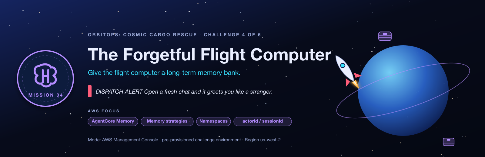
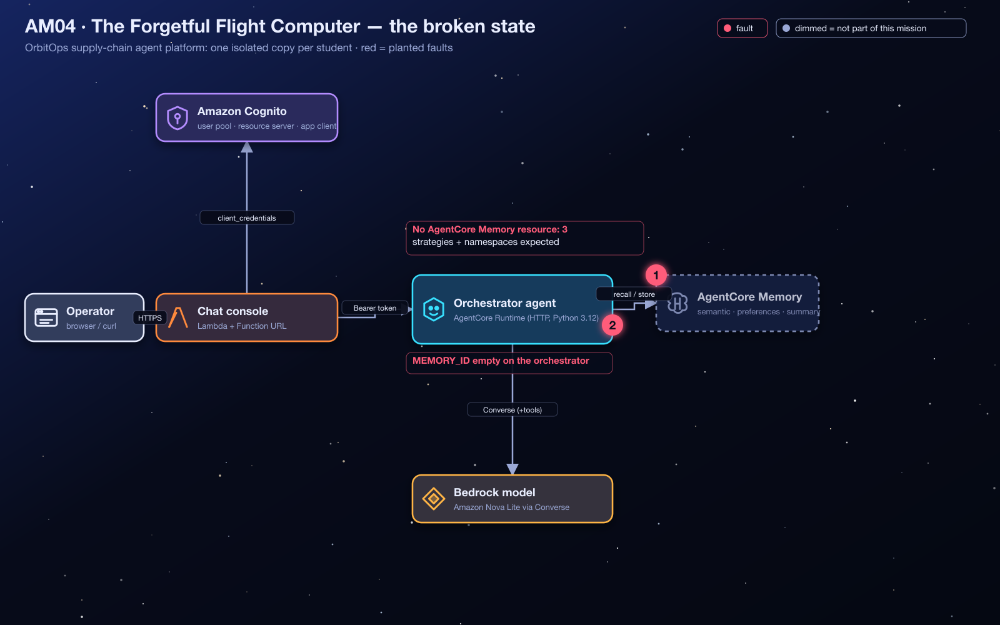
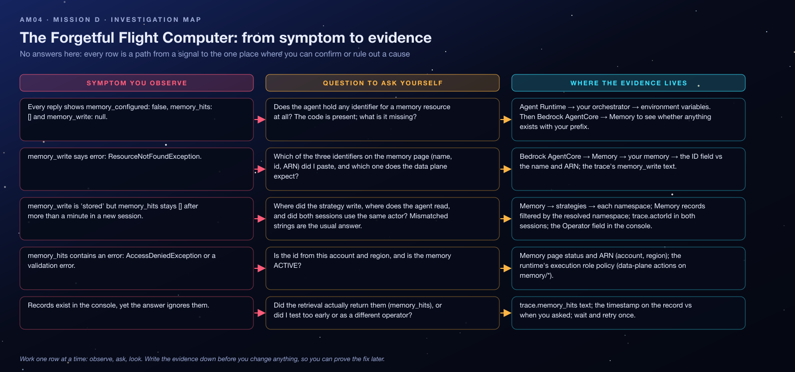

<sub>[⬅ All missions](../README.md) · [⬅ AM03 The Vanishing Starport Manuals](../AM03-knowledge-base-specialist/README.md) · [AM05 Close the Exposed Hyperspace Lanes ➡](../AM05-vpc-private-networking/README.md)</sub>

<p align="center"></p>

# AM04 — Mission D: The Forgetful Flight Computer — Student Handout

**OrbitOps: Cosmic Cargo Rescue** · Challenge D of 6
**AWS focus:** Amazon Bedrock AgentCore Memory, long-term memory strategies, namespaces, `actorId` / `sessionId`
**Mode:** AWS Management Console (CLI optional) · pre-provisioned challenge environment · **Region `us-west-2`**

> [!IMPORTANT]
> Work only on resources prefixed with your student id. Choose a unique memory name containing your id (letters, digits, underscores).

> [!WARNING]
> **Dispatch alert:** Tell the OrbitOps flight controller your preferred reporting style, then open a fresh chat. It greets you like a stranger. The flight computer has all its memory circuitry, but no memory bank.

## Lab Goals

- Understand the two halves of **AgentCore Memory**: **short-term** events (the raw conversation, per actor and session) and **long-term** records that strategies **extract asynchronously** into **namespaces**.
- Create a memory resource with the three built-in strategies (**semantic**, **user preference**, **summarization**) and namespaces that match what the application code expects.
- Connect it to the orchestrator and prove recall **across sessions**.

## The Situation

The orchestrator already contains the memory integration: at the start of each turn it **retrieves** long-term records for the operator (`actorId`) from two namespaces, and at the end it **stores** the user and assistant messages as an event. However, **no AgentCore Memory resource has been provisioned**, so the code is inert and operator preferences vanish between sessions.

Activate durable memory without rewriting the agent.

## Architecture

<p align="center"></p>

## What Is Already In Place

| Value | Notes |
|---|---|
| `chat_urls[<you>]` | Chat console. The sidebar has an **Operator (actorId)** field (default `captain-nova`) and a **New session** button. The trace shows `memory_configured`, `memory_hits`, `memory_write`. |
| `orchestrator_runtime_ids[<you>]` | Where `MEMORY_ID` lives. |
| `memory_execution_role_arns[<you>]` | An IAM role AgentCore Memory may use for extraction (**Solution resources**). |
| The agent's memory code | Reads from namespaces `supplychain/user/{actorId}/preferences` and `supplychain/user/{actorId}/semantic`; writes events with your `actorId` and the chat `sessionId`. |

The three namespace patterns the application expects. **Keep their structure and variable names intact:**

```text
supplychain/user/{actorId}/semantic
supplychain/user/{actorId}/preferences
supplychain/user/{actorId}/session/{sessionId}/summary
```

The curly-braced values are **namespace placeholders** that AgentCore fills in per actor and session. They are not text to replace with a test user id.

## Starting Symptoms

1. Say *"I'm Captain Nova, and I prefer detailed shipment reports."* Click **New session** and ask *"How should you format my shipment reports?"* → the agent has no idea.
2. Trace on every reply: `memory_configured: false`, `memory_hits: []`, `memory_write: null`.

## Time Limit

**35 minutes** (plus a 60-second wait for extraction).

## Your Repair Objectives

- [ ] Create an **AgentCore Memory resource** with a unique name and an event expiry of at least **7 days** (the brief's requirement; the console's default is 90). Use the provided execution role if the console asks for one (for built-in strategies it currently does not).
- [ ] Configure the three **long-term memory strategies** and pair each with the corresponding namespace:
  - **Semantic memory** → `supplychain/user/{actorId}/semantic`
  - **User preferences** → `supplychain/user/{actorId}/preferences`
  - **Session summaries** → `supplychain/user/{actorId}/session/{sessionId}/summary`
- [ ] Wait for the memory and its strategies to be **`ACTIVE`**.
- [ ] Set the orchestrator runtime environment variable **`MEMORY_ID`** to the memory **resource id** (not its display name, not its ARN).
- [ ] Through the chat console, as actor `captain-nova`, submit a message that reveals a stable preference, for example **"I'm Captain Nova, and I prefer detailed shipment reports."**
- [ ] Allow **at least 60 seconds** for asynchronous extraction before checking.

## Concept Briefing

- **Events (short-term).** `CreateEvent` stores conversation turns keyed by `actorId` + `sessionId`. They expire after the memory's event expiry duration.
- **Strategies (long-term).** Each built-in strategy runs a model over new events and writes **memory records** into a **namespace**: semantic facts, user preferences, or session summaries. Extraction is **asynchronous** (tens of seconds).
- **Namespaces are the contract.** The agent asks for records *in a specific namespace*. If the strategy writes to a different one (for example the default `/strategies/{memoryStrategyId}/actors/{actorId}`), the records exist but the agent never sees them.
- **Actor identity.** Recall is per actor. Testing with two different actor ids is the classic way to fool yourself.

## Investigation Map

Before touching anything, read the map: every row is a path from a signal you can observe to the one place where you can confirm or rule out a cause. It contains no answers, only places to look.

<p align="center"></p>

## Guided Investigation Hints

> [!TIP]
> **How to use the hints.** Collect the evidence in the checklist first. Then open hints top-down, one objective at a time, and **stop reading the moment you get an idea** so you can go test it. Each objective has three levels: *Where to look* → *What to compare* → *The nudge*. Level 3 never states the answer, but it leaves you one short step away.

### Evidence to collect before opening any hint

- [ ] The trace of one reply: `memory_configured`, `memory_hits`, `memory_write`, and the `actorId` / `sessionId` it reports.
- [ ] The three namespace patterns from *What Is Already In Place*, copied somewhere you can paste from.
- [ ] The orchestrator's environment variables (which memory-related one exists, and what it holds).
- [ ] Whether Bedrock AgentCore → **Memory** lists anything with your student id.

### Hint ladder — Objective 1 · the memory resource and its strategies

<details><summary><b>Level 1 · Where to look</b></summary>

Bedrock AgentCore → **Memory** → Create. Read the whole form before typing: there is a short-term section (an expiry in days), a role, and a long-term section where strategies are added one by one. Each strategy has a field for the namespace it writes to.
</details>

<details><summary><b>Level 2 · What to compare</b></summary>

Compare the three strategy *types* the form offers with the three namespace patterns in the handout: the last word of each pattern tells you which strategy it belongs to. Then compare the namespace the form *pre-fills* with the pattern you need. They are not the same, and the agent only reads one of them.
</details>

<details><summary><b>Level 3 · The nudge</b></summary>

Type the patterns with the curly braces exactly as written; `{actorId}` and `{sessionId}` are placeholders the service fills in. The expiry has a floor of seven days. After creation, the memory and each strategy show their own status; wait for all of them to be `ACTIVE`. The identifier Objective 2 needs is the one that looks like `<name>-<random letters>`.
</details>

### Hint ladder — Objective 2 · connecting the orchestrator

<details><summary><b>Level 1 · Where to look</b></summary>

The orchestrator's environment variables, and the memory's detail page, which shows three identifiers: a name, an id and an ARN.
</details>

<details><summary><b>Level 2 · What to compare</b></summary>

Compare `memory_write` in the trace across your attempts: `null` means the code never tried, `"stored"` means the write succeeded, and `"error: …"` quotes the service's own complaint. A *not found* error after you set the variable tells you which of the three identifiers you pasted.
</details>

<details><summary><b>Level 3 · The nudge</b></summary>

Once the runtime is `READY` again, send the preference sentence as `captain-nova` and confirm `memory_write: "stored"`. Then do nothing for a full minute: the extraction that turns events into records is asynchronous. Look at the memory's **records** for the resolved preferences namespace *before* you run the new-session test, so you know which stage to blame if it fails.
</details>

### Stuck? Symptom decision tree

```text
Is memory_configured false?
├─ yes → Objective 2 (the variable is empty; nothing else can be tested)
└─ no  → What does memory_write say?
         ├─ "error: … ResourceNotFound…"  → Objective 2: you pasted the wrong identifier
         ├─ "error: … AccessDenied…"      → wrong account/region, or the memory is not ACTIVE yet
         └─ "stored" → wait 60 s, then list records under supplychain/user/captain-nova/preferences
                  ├─ no records → Objective 1: the strategy's namespace is not what the agent reads,
                  │               or the actor in the Operator field is not the one you think
                  └─ a record  → New session (same operator). Does memory_hits contain it?
                                 ├─ no  → different actorId? check trace.actorId in both sessions
                                 └─ yes → Flight Test. You are done.
```

### Self-check before you call the instructor

- [ ] Memory status `ACTIVE`, event expiry ≥ 7 days, all three strategies `ACTIVE`?
- [ ] Three strategies, one of each type, each with the exact namespace from the handout (braces included, no real ids)?
- [ ] `MEMORY_ID` set to the **id** (not the name, not the ARN), runtime back to `READY`?
- [ ] Session 1 trace shows `memory_write: "stored"`?
- [ ] I waited at least 60 seconds and saw a record under the resolved preferences namespace?
- [ ] Session 2 uses **New session** with the **same Operator** value?

### Red herrings (don't go down these holes)

- **The orchestrator's code.** It is correct and already reads the right namespaces; do not redeploy it.
- **The chat handler.** It only forwards `actorId` and `sessionId`; nothing to fix there.
- **Short-term memory alone.** Events are written per session; recall *across* sessions comes from long-term records, which need strategies.
- **The session id format.** The console generates valid ids; "New session" is the only session control you need.
- **The execution role.** It is pre-built; if the console asks, select it, do not create another.

### What a good hypothesis sounds like

> *"Because `memory_write` says `stored` but there are no records under `supplychain/user/captain-nova/preferences` after two minutes, I expect the user-preference strategy to be writing to a different namespace. Test: open the memory's strategies and compare each namespace, character by character, with the handout."*

State the evidence, the expectation, and the one test that would prove you wrong. Then run the test.

## Debugging Playbook (How a Pro Thinks)

| Signal | Layer | First move |
|---|---|---|
| `memory_configured: false` | Config | `MEMORY_ID` empty |
| `memory_write: "error: … ResourceNotFound"` | Wrong id | You pasted the name or ARN |
| `memory_write: "stored"` but `memory_hits` stays empty after 60 s | Namespaces | Strategy namespace ≠ queried namespace, or different `actorId` |
| `memory_hits` has `error: AccessDenied` | IAM | The orchestrator role only allows the data-plane actions on `memory/*` in this account; verify the id belongs to this account/region |

Mental model: **write path** (events) and **read path** (records in namespaces) are different systems joined by asynchronous extraction. Confirm the write, then the extraction, then the read.

## Things to Check

- **Bedrock AgentCore → Memory → your memory:** status `ACTIVE`, strategies and their namespaces, event expiry.
- **Bedrock AgentCore → Memory → your memory → memory records / events** (per actor and session).
- **Bedrock AgentCore → Runtime → the orchestrator → environment variables:** `MEMORY_ID`.
- **Chat console → trace:** `memory_configured`, `memory_hits`, `memory_write`, `actorId`, `sessionId`.

## Flight Test

1. Session 1 (actor `captain-nova`): *"I'm Captain Nova, and I prefer detailed shipment reports."* → trace `memory_write: "stored"`.
2. Wait 60 seconds.
3. Click **New session** (same actor) and ask: *"How should you format my shipment reports?"* → the agent answers "detailed" without being reminded; trace `memory_hits` contains a preference record.

**Mission accomplished when:** the orchestrator recalls a previously supplied user preference **across sessions**.

> [!NOTE]
> **Mission control note:** Memory extraction is asynchronous; the original challenge expects roughly 30–60 seconds, and timing varies. Use the same actor for both sessions. The namespace content, not its slashes, must match the application.

## Key Takeaways

- **Memory is a resource plus strategies**; the agent code only supplies the id, actor and session.
- **Namespaces are an API contract** between the strategy configuration and the application code.
- **Extraction is asynchronous**; validation needs a wait and the same `actorId`.
- **Use the resource id** in `MEMORY_ID`.

## Reflection Questions

1. Why does the application keep three strategies instead of one? What would a session summary give an operator that a preference record does not?
2. If two operators share a laptop and the same `actorId`, what happens to their preferences? How would you fix that in the chat handler?
3. Events expire; long-term records don't. Which one would you clear for a "forget me" request, and how?

**Coming next:** The flight computer remembers everything, but the communications paths still need to be secured.

---

> [!NOTE]
> **Finished, or out of time?** Your instructor walks through the fix live and then shares the **debrief guide** for this mission: the root causes, every console step with screenshots, the exam angle and model answers to the reflection questions. Try the hint ladder first: the struggle is where the learning happens.

<sub>[⬅ All missions](../README.md) · [⬅ AM03 The Vanishing Starport Manuals](../AM03-knowledge-base-specialist/README.md) · [AM05 Close the Exposed Hyperspace Lanes ➡](../AM05-vpc-private-networking/README.md)</sub>
