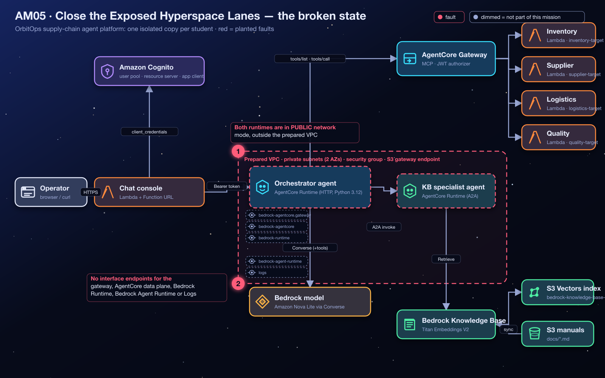
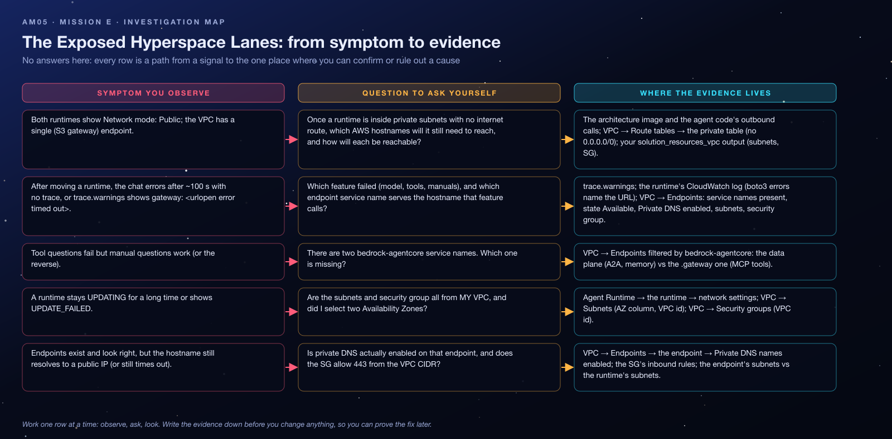

<sub>[⬅ All missions](../README.md) · [⬅ AM04 The Forgetful Flight Computer](../AM04-agentcore-memory/README.md) · [AM06 The Leaky Captain's Log ➡](../AM06-bedrock-guardrails/README.md)</sub>

<p align="center"></p>

# AM05 — Mission E: Close the Exposed Hyperspace Lanes — Student Handout

**OrbitOps: Cosmic Cargo Rescue** · Challenge E of 6
**AWS focus:** Amazon VPC, AWS PrivateLink, VPC interface endpoints (private DNS), AgentCore Runtime **VPC network mode**
**Mode:** AWS Management Console (CLI optional) · pre-provisioned challenge environment · **Region `us-west-2`**

> [!IMPORTANT]
> You have your **own VPC** (`orbit-<you>-am05-vpc`). Create endpoints only there. Interface endpoints with private DNS can exist only once per service per VPC, which is exactly why every student gets a VPC. PrivateLink endpoints cost ~$0.01 per hour each: create the four you need, no duplicates.

> [!WARNING]
> **Dispatch alert:** OrbitOps is exchanging operational traffic using public network access. Security command wants the two agent runtimes placed in protected subnets, with private connectivity to the AWS services they use. Cargo routes are not the only routes that need protection.

## Lab Goals

- Move AgentCore runtimes from **Public** to **VPC** network mode and understand what that changes (the agent's *outbound* traffic now originates inside your subnets).
- Provide **private connectivity** to the AWS APIs the agents call, using **PrivateLink interface endpoints** with **private DNS**.
- Reason about **which services need an endpoint** by reading what the agents actually call.

## The Situation

Both the **orchestrator** and the **knowledge-base specialist** runtimes run in **Public** mode. A VPC has been prepared for you with public and private subnets in two Availability Zones, an internet gateway for the public tier, an **S3 gateway endpoint**, and a security group. The private subnets have **no route to the internet** on purpose. Move both runtimes into the private subnets and give them private paths to every AWS API they depend on.

## Architecture

<p align="center"></p>

What the agents call from inside the VPC once moved: the **AgentCore Gateway** (tools), the **AgentCore data plane** (the orchestrator's A2A call to the specialist; also Memory in other missions), **Bedrock Runtime** (model invocation from both agents), **Bedrock Agent Runtime** (the specialist's knowledge-base `Retrieve` call), **CloudWatch Logs**, and **S3** (already covered by the gateway endpoint). Everything *inbound* to the runtimes (the chat handler's call) still arrives through the AWS-managed AgentCore endpoint and is unaffected.

## What Is Already In Place

Your `solution_resources_vpc[<you>]` output:

| Key | Notes |
|---|---|
| `VpcId`, `VpcCidr` | Your VPC (DNS support and hostnames enabled) |
| `PrivateSubnetIds` (2) | One per AZ; route table has **no** default route (no NAT); S3 gateway endpoint attached |
| `PublicSubnetIds` (2) | Internet gateway route; not for runtimes |
| `PrivateRouteTableId` | The private tier's route table |
| `SecurityGroupId` | Allows inbound **TCP 443 from the VPC CIDR** and all outbound |

Plus a working platform from Missions A–C: Cognito auth, Gateway with four targets, orchestrator, specialist with a synced knowledge base (`orchestrator_runtime_ids`, `kb_specialist_runtime_arns`).

## Starting Symptoms

1. Both runtimes show **Network mode: Public**.
2. Your VPC has exactly one endpoint (the S3 gateway endpoint).
3. Chat works (today's traffic goes over AWS public endpoints).

## Time Limit

**45 minutes** (network updates on runtimes take a few minutes each).

## Your Repair Objectives

- [ ] In your VPC, create **interface endpoints** for:

  | AWS service | Service name to find |
  |---|---|
  | AgentCore Gateway | `com.amazonaws.<region>.bedrock-agentcore.gateway` |
  | AgentCore data plane (Runtime, Memory) | `com.amazonaws.<region>.bedrock-agentcore` |
  | Amazon Bedrock Runtime | `com.amazonaws.<region>.bedrock-runtime` |
  | Amazon Bedrock Agent Runtime (knowledge-base `Retrieve`) | `com.amazonaws.<region>.bedrock-agent-runtime` |
  | Amazon CloudWatch Logs | `com.amazonaws.<region>.logs` |

  Replace `<region>` with **`us-west-2`**; do not type it literally.

- [ ] Enable **private DNS** on each interface endpoint and place it in **both private subnets**.
- [ ] Associate the provided **security group** with the interface endpoints **and** both agent runtimes.
- [ ] Change the network mode of **each** runtime from **Public** to **VPC**, selecting the **private subnets**.
- [ ] Wait for **both runtimes to return to `READY`** after the network change.

Do not move the runtimes to the public subnets as a shortcut, and do not add a NAT gateway: the exercise is to make every dependency reachable privately.

## Concept Briefing

- **VPC mode.** The runtime attaches an elastic network interface in your subnets; its outbound calls use your route tables and security groups. Inbound invocation is unchanged.
- **Interface endpoint + private DNS.** An interface endpoint is an ENI with a private IP for one AWS service. With **private DNS**, the service's normal hostname (`bedrock-runtime.us-west-2.amazonaws.com`) resolves to that private IP inside the VPC, so the agent code needs no changes. Without private DNS you would have to use endpoint-specific hostnames.
- **Gateway endpoints** (S3, DynamoDB) are route-table entries and free; **interface endpoints** are per-AZ ENIs billed hourly.
- **Why no Cognito endpoint?** The runtimes never call Cognito: the orchestrator forwards the caller's bearer token, and the JWT authorizers run in the AWS-managed layer. (The micro-credential's environment has the orchestrator mint its own token and therefore keeps a NAT gateway for Cognito; here that lane is closed too.)

## Investigation Map

Before touching anything, read the map: every row is a path from a signal you can observe to the one place where you can confirm or rule out a cause. It contains no answers, only places to look.

<p align="center"></p>

## Guided Investigation Hints

> [!TIP]
> **How to use the hints.** Collect the evidence in the checklist first. Then open hints top-down, one objective at a time, and **stop reading the moment you get an idea** so you can go test it. Each objective has three levels: *Where to look* → *What to compare* → *The nudge*. Level 3 never states the answer, but it leaves you one short step away.

### Evidence to collect before opening any hint

- [ ] Every key in `solution_resources_vpc[<you>]`: VPC id, the two private subnet ids (and their AZs), the security group id.
- [ ] The private route table's routes (what is there, and what is *not*).
- [ ] The current list of endpoints in your VPC (type, service name, state).
- [ ] A written inventory of every AWS hostname the two agents contact (the architecture section lists the services; the agent code confirms them).

### Hint ladder — Objective 1 · the interface endpoints

<details><summary><b>Level 1 · Where to look</b></summary>

VPC → **Endpoints** → Create endpoint. Type the first word of the service you need into the service search and read *all* the results: some AWS services publish more than one endpoint service name.
</details>

<details><summary><b>Level 2 · What to compare</b></summary>

Compare your dependency inventory (model calls, tool calls, the agent-to-agent call, the specialist's knowledge-base search, logs, S3) with the endpoint list. S3 is already covered by a *gateway* endpoint; everything else needs an *interface* endpoint. Then compare the two `bedrock-agentcore` results with the two different hostnames the orchestrator calls (one for tools, one for the specialist). Which hostname does each service name serve?
</details>

<details><summary><b>Level 3 · The nudge</b></summary>

For each endpoint: Interface type, your VPC, **both** private subnets, the lab security group, and the setting under *Additional settings* that lets the service's normal hostname resolve privately. Without that switch the agent code would have to use endpoint-specific hostnames, which it does not. You should end with exactly five new endpoints, each `Available`.
</details>

### Hint ladder — Objective 2 · the runtimes' network mode

<details><summary><b>Level 1 · Where to look</b></summary>

Bedrock AgentCore → Runtime → the runtime → **Update runtime**. The network section offers two modes; the second one asks for subnets and security groups.
</details>

<details><summary><b>Level 2 · What to compare</b></summary>

Compare the subnet ids the form offers with the two *private* ids in your outputs (the public ones are there for contrast: AgentCore gives a runtime's network interface a private IP only, so a public subnet gives it no internet access anyway, and the brief requires the private tier). Compare the number of runtimes you have with the number you have updated: the orchestrator reaches the specialist privately, but the specialist still answers from wherever *it* lives.
</details>

<details><summary><b>Level 3 · The nudge</b></summary>

Saving publishes a new version and the status cycles through `UPDATING` for several minutes; do not judge the result until both runtimes read `READY`. If something then times out, notice *which feature* failed (model, tools or manuals) and *how*: a `gateway: <urlopen error timed out>` warning in the trace, or a chat error after about 100 seconds with no trace at all. Each feature calls a hostname that maps to exactly one service name in Objective 1, and boto3 errors in the runtime's CloudWatch log name the URL outright.
</details>

### Stuck? Symptom decision tree

```text
Are both runtimes READY in VPC mode?
├─ no, one is stuck UPDATING / UPDATE_FAILED → subnets and SG from MY VPC? two AZs? private subnets?
└─ yes → Send a tool question and a manual question.
         ├─ every question: chat error after ~100 s, no trace    → endpoint for the model (bedrock-runtime) missing or no private DNS
         ├─ tools fail, warning gateway: <urlopen error timed out> → the .gateway service name is missing
         ├─ tools work, manual question errors after ~100 s      → data-plane or bedrock-agent-runtime endpoint missing
         │                                                        (or the specialist is still updating / still PUBLIC)
         ├─ everything works but Network mode still says Public  → Objective 2 was saved on the wrong runtime
         └─ both answer, warnings [] on both                       → Flight Test. You are done.
```

### Self-check before you call the instructor

- [ ] Five interface endpoints, service names `…bedrock-agentcore.gateway`, `…bedrock-agentcore`, `…bedrock-runtime`, `…bedrock-agent-runtime`, `…logs`, all `Available`?
- [ ] Each endpoint: private DNS enabled, both private subnets, the lab security group?
- [ ] No duplicate endpoints (and no endpoint in the public subnets)?
- [ ] **Both** runtimes: Network mode VPC, the two private subnets, the lab SG, status `READY`?
- [ ] The private route table still has no `0.0.0.0/0` route (no NAT added)?
- [ ] A tool question **and** a manual question both answer with empty `warnings`?

### Red herrings (don't go down these holes)

- **A NAT gateway.** It would "fix" the timeouts and fail the mission; nothing here needs the public internet.
- **A Cognito endpoint.** The runtimes never call Cognito in this track; the token is forwarded.
- **The public subnets.** They exist for contrast; the runtimes do not belong there.
- **Security group rules.** The lab SG already allows 443 from the VPC CIDR and all outbound.
- **The S3 endpoint.** Already present as a gateway endpoint; do not add an interface one.

### What a good hypothesis sounds like

> *"Because tool questions work but manual questions end in a chat error after about 100 seconds, and the specialist's log shows no new invocation, I expect the data-plane endpoint (not the `.gateway` one) to be missing or to lack private DNS. Test: filter VPC → Endpoints by `bedrock-agentcore` and read the service names and the private DNS column."*

State the evidence, the expectation, and the one test that would prove you wrong. Then run the test.

## Debugging Playbook (How a Pro Thinks)

| Signal | Layer | First move |
|---|---|---|
| Runtime stuck `UPDATING` for >10 min | Subnets/SG | Subnets in your VPC? SG in the same VPC? Two AZs selected? |
| Trace `warnings: gateway: <urlopen error … timed out>` | Missing `bedrock-agentcore.gateway` endpoint | Create it with private DNS |
| Tools work; a manual question ends in a chat error after ~100 s | Missing `bedrock-agentcore` (data plane) or `bedrock-agent-runtime` endpoint | Specialist log shows no invocation → data plane; a timeout naming `bedrock-agent-runtime` → that one |
| Every question ends in a chat error after ~100 s, no trace | Missing `bedrock-runtime` endpoint | Create it; the runtime's log names the URL |
| Endpoint shows `pending` | Normal for 1–2 min | Wait, then check `available` |

Mental model: in VPC mode the runtime is a **host inside your network**. Every outbound dependency must be reachable through **your** routing: endpoint, NAT, or nothing.

## Things to Check

- **VPC → Endpoints:** five interface endpoints `available`, private DNS enabled, subnets = your two private subnets, SG = lab SG.
- **VPC → Route tables → private:** S3 gateway endpoint route present; no `0.0.0.0/0`.
- **Bedrock AgentCore → Runtime → each runtime:** Network mode VPC, subnets, security group, status `READY`.
- **Chat console trace** after the change.

## Flight Test

From the same chat console, verify both paths still work:

1. **Tool request:** *"Where is shipment SHP-1002?"* → logistics data via the Gateway.
2. **Document request:** *"What does the quality manual say about cryogenic seals?"* → the specialist answers from the manuals (`specialist_consulted: true`).

**Mission accomplished when:** both agent runtimes are in **VPC mode** and the console still answers Gateway-tool and knowledge-base questions, using the interface endpoints for the supported AWS APIs.

> [!NOTE]
> **Mission control note:** Network updates can take several minutes. Validate only after both runtimes are `READY`. PrivateLink endpoints cost money per hour: check existing endpoints before creating duplicates.

## Key Takeaways

- **VPC mode changes outbound, not inbound.** Inventory every outbound dependency.
- **Private DNS is what keeps application code unchanged.**
- **Two `bedrock-agentcore` endpoints exist** (data plane and gateway); agents that use both need both.
- **No NAT is required** when every dependency has an endpoint and nothing needs the public internet.

## Reflection Questions

1. Which of these endpoints would you still need if the agents used only the knowledge base and no Gateway?
2. The chat handler Lambda is *not* in the VPC. Why does it not need an endpoint to reach the runtime?
3. If the orchestrator fetched its own Cognito token, what would you add to the private tier, and what would it cost?

**Coming next:** The routes are secure. Now stop sensitive information from escaping in the messages themselves.

---

> [!NOTE]
> **Finished, or out of time?** Your instructor walks through the fix live and then shares the **debrief guide** for this mission: the root causes, every console step with screenshots, the exam angle and model answers to the reflection questions. Try the hint ladder first: the struggle is where the learning happens.

<sub>[⬅ All missions](../README.md) · [⬅ AM04 The Forgetful Flight Computer](../AM04-agentcore-memory/README.md) · [AM06 The Leaky Captain's Log ➡](../AM06-bedrock-guardrails/README.md)</sub>
