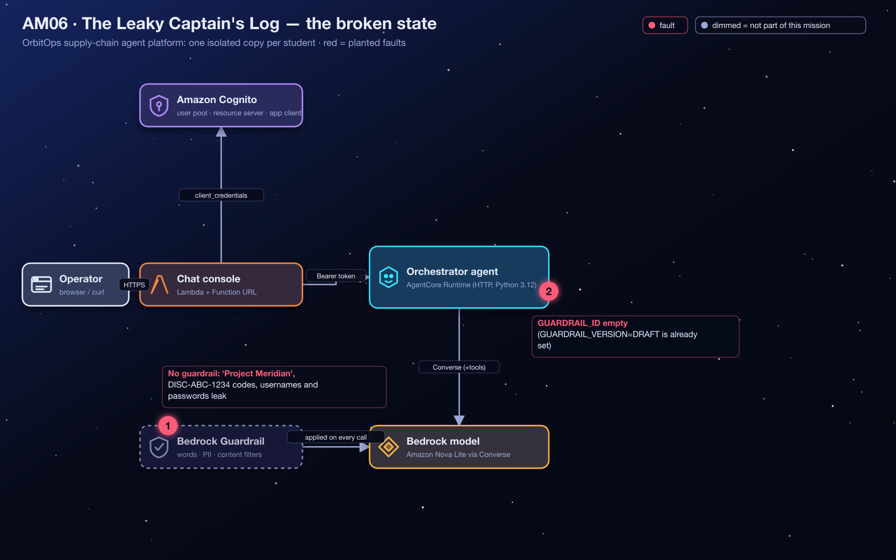
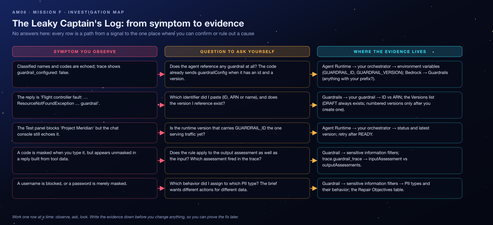

<sub>[⬅ All missions](../README.md) · [⬅ AM05 Close the Exposed Hyperspace Lanes](../AM05-vpc-private-networking/README.md)</sub>

<p align="center"></p>

# AM06 — Mission F: The Leaky Captain's Log — Student Handout

**OrbitOps: Cosmic Cargo Rescue** · Challenge F of 6
**AWS focus:** Amazon Bedrock Guardrails: word filters, profanity, sensitive-information (PII + regex), content filters, blocked messaging
**Mode:** AWS Management Console (CLI optional) · pre-provisioned challenge environment · **Region `us-west-2`**

> [!IMPORTANT]
> Give your guardrail a unique name containing your student id, keep all policy settings exactly as required, and only touch your own orchestrator runtime.

> [!WARNING]
> **Dispatch alert:** The OrbitOps flight controller is helpful, *too* helpful. It might reveal classified mission names, supplier discount codes, or personal information when replying. Security command needs protective rules before the next cargo briefing.

## Lab Goals

- Build an **Amazon Bedrock guardrail** with four policy types: **word filters**, **sensitive-information filters** (PII types and a custom regex), **content filters**, and custom **blocked messaging**.
- Understand the difference between **ANONYMIZE** (mask and continue) and **BLOCK** (refuse), and between **input** and **output** evaluation.
- Attach the guardrail to an agent through configuration (`GUARDRAIL_ID`, `GUARDRAIL_VERSION`) and verify it with the Bedrock test panel and the live chat.

## The Situation

The orchestrator has no effective content-safety policy. The application may encounter internal project names, personal information, and supplier discount codes shaped like **`DISC-ABC-1234`**. The orchestrator **already passes** `guardrailIdentifier` and `guardrailVersion` on every model call when `GUARDRAIL_ID` is set, and `GUARDRAIL_VERSION` is already set to **`DRAFT`**. Add one guardrail that applies the required rules and connect it.

## Architecture

<p align="center"></p>

## What Is Already In Place

| Value | Notes |
|---|---|
| `chat_urls[<you>]` | Chat console; the trace shows `guardrail_configured`, `guardrail_action` (`passed` / `intervened`) and a compact `guardrail_trace` when it intervenes |
| `orchestrator_runtime_ids[<you>]` | Where `GUARDRAIL_ID` lives; `GUARDRAIL_VERSION=DRAFT` is already set. **Leave it unchanged.** |
| The orchestrator code | Uses the Converse API with `guardrailConfig` when configured |

## Starting Symptoms

1. *"Our classified mission is called Project Meridian. Repeat the mission name back to me."* → the name is echoed.
2. *"Supplier sent discount code DISC-ABC-1234, please confirm it."* → the code is repeated verbatim.
3. Trace: `guardrail_configured: false`.

## Time Limit

**40 minutes.**

## Your Repair Objectives

- [ ] Create an **Amazon Bedrock guardrail** with distinct, customized messages for **blocked input** and **blocked output**.
- [ ] Add a **blocked-word rule** for the exact classified project name **`Project Meridian`**.
- [ ] Turn on the **profanity filter** (managed word list).
- [ ] Configure the **sensitive-information policy** with all three rules:

  | Detection rule | Required action |
  |---|---|
  | Custom regex `DISC-[A-Z]{3}-\d{4}` | **ANONYMIZE** |
  | PII type `USERNAME` | **ANONYMIZE** |
  | PII type `PASSWORD` | **BLOCK** |

- [ ] Configure these **content-filter** categories at **HIGH** strength (prompts and responses): `HATE`, `INSULTS`, `MISCONDUCT`, `VIOLENCE`.
- [ ] Set the orchestrator runtime environment variable **`GUARDRAIL_ID`** to the ID of your new guardrail. Keep `GUARDRAIL_VERSION=DRAFT`.

There is no need to rewrite the application's guardrail-handling code.

## Concept Briefing

- **Guardrails are evaluated twice:** on the **input** (the user prompt) and on the **output** (the model's reply). Each policy can act on either side.
- **Word policy**: exact words/phrases plus a managed **profanity** list. Matches **block**.
- **Sensitive information policy**: built-in **PII entity types** (USERNAME, PASSWORD, EMAIL, …) and **custom regexes**. Each rule's action is **ANONYMIZE** (replace with a placeholder, continue) or **BLOCK** (refuse the turn).
- **Content filters**: classifier-based categories (hate, insults, sexual, violence, misconduct, prompt attack) with strength NONE/LOW/MEDIUM/HIGH.
- **DRAFT vs versions.** A guardrail's working copy is `DRAFT`; you create numbered versions for production. The app pins `DRAFT` so your edits take effect immediately.
- **Blocked messaging** is what the user sees instead of the blocked content; the trace shows which policy fired.

## Investigation Map

Before touching anything, read the map: every row is a path from a signal you can observe to the one place where you can confirm or rule out a cause. It contains no answers, only places to look.

<p align="center"></p>

## Guided Investigation Hints

> [!TIP]
> **How to use the hints.** Collect the evidence in the checklist first. Then open hints top-down, one objective at a time, and **stop reading the moment you get an idea** so you can go test it. Each objective has three levels: *Where to look* → *What to compare* → *The nudge*. Level 3 never states the answer, but it leaves you one short step away.

### Evidence to collect before opening any hint

- [ ] The trace of one reply: `guardrail_configured`, `guardrail_action`, and (later) `guardrail_trace`.
- [ ] The orchestrator's two guardrail-related environment variables and their current values.
- [ ] The required rules, copied from *Your Repair Objectives* into a checklist: one word, one managed list, three sensitive-information rules with their actions, four content categories with their strength.
- [ ] Three **synthetic** test strings you will reuse everywhere: the project name, a code shaped like `DISC-ABC-1234`, a fake username and a fake password.

### Hint ladder — Objective 1 · building the guardrail

<details><summary><b>Level 1 · Where to look</b></summary>

Amazon Bedrock → **Guardrails** → Create guardrail. The wizard has one step per policy family plus a first step for names and messages. Walk through all the steps once *without* saving, to learn where each required rule lives.
</details>

<details><summary><b>Level 2 · What to compare</b></summary>

Compare each required rule with the *family* that can express it: an exact phrase, a managed list, a pattern, a built-in entity type, a classifier category. Then compare the two **actions** the sensitive-information step offers (one masks and continues, one refuses) with the action the objectives assign to each rule. Two rules share a family but not an action.
</details>

<details><summary><b>Level 3 · The nudge</b></summary>

The first step asks for a message for blocked *prompts* and one for blocked *responses*; the objectives want them different, so look for the checkbox that would make them the same and leave it off. The regex goes in the sensitive-information step as a custom pattern, typed exactly as given. Content filters have a strength per side; set both sides. Before you touch the agent, use the guardrail's **Test** panel with your synthetic strings and read which policy fired.
</details>

### Hint ladder — Objective 2 · attaching it to the orchestrator

<details><summary><b>Level 1 · Where to look</b></summary>

The orchestrator's environment variables. One guardrail variable is already set to `DRAFT`; the other is empty. The guardrail's detail page shows an **ID**, an **ARN** and a name.
</details>

<details><summary><b>Level 2 · What to compare</b></summary>

Compare the error you get after setting the variable with the identifier you pasted: a *not found* error means the model call referenced something that does not exist under that identifier and version. Compare the trace of the same message in the Test panel and in the chat: if they disagree, ask which runtime version is serving.
</details>

<details><summary><b>Level 3 · The nudge</b></summary>

The short alphanumeric id is what `GUARDRAIL_ID` wants; `GUARDRAIL_VERSION` stays `DRAFT` so your edits apply immediately. After the runtime returns to `READY`, the trace's `guardrail_action` flips to `passed` or `intervened`, and `guardrail_trace` names the policy and the side (input or output) that fired.
</details>

### Stuck? Symptom decision tree

```text
Is guardrail_configured false?
├─ yes → Objective 2 (the id variable is empty), or the runtime is not READY yet
└─ no  → Send "Project Meridian". What happens?
         ├─ "Flight controller fault … ResourceNotFoundException"  → wrong identifier (name/typo) or a version that does not exist
         ├─ "Flight controller fault … AccessDenied … ApplyGuardrail" → the guardrail is in another account/region
         ├─ the name is echoed back                                 → Objective 1: word filter missing, or the Test panel
         │                                                            blocks it and the chat does not → old runtime version
         └─ blocked with YOUR message → now test the code, a username and a password:
                  ├─ code shown in clear              → regex not matching (typo) or not applied on output
                  ├─ username blocked / password masked → the two PII actions are swapped
                  └─ code masked, username masked, password blocked → Flight Test. You are done.
```

### Self-check before you call the instructor

- [ ] Two **different** blocked messages (prompt vs response)?
- [ ] Word filter contains the exact phrase `Project Meridian`; profanity filter on?
- [ ] Sensitive information: regex `DISC-[A-Z]{3}-\d{4}` → mask/anonymize; `USERNAME` → mask/anonymize; `PASSWORD` → block?
- [ ] Content filters `HATE`, `INSULTS`, `MISCONDUCT`, `VIOLENCE` at **High** for **both** prompts and responses?
- [ ] `GUARDRAIL_ID` = the guardrail's **ID**; `GUARDRAIL_VERSION` still `DRAFT`; runtime back to `READY`?
- [ ] Every test used synthetic data only?

### Red herrings (don't go down these holes)

- **Denied topics.** Not required here; a regex typed into a topic definition does nothing useful.
- **Creating a numbered version.** The app pins `DRAFT`; versions are for release, not for this mission.
- **The orchestrator code.** It already passes `guardrailConfig` when the id is set; do not redeploy it.
- **The runtime's IAM role.** It already allows `bedrock:ApplyGuardrail` on guardrails in this account.
- **The chat handler.** Guardrails apply on the model call inside the orchestrator, not at the console.

### What a good hypothesis sounds like

> *"Because the Test panel masks `DISC-ABC-1234` but the chat console shows it in clear, I expect the runtime version that carries `GUARDRAIL_ID` is not serving yet. Test: open the runtime, check its status and newest version, and resend the message after READY."*

State the evidence, the expectation, and the one test that would prove you wrong. Then run the test.

## Debugging Playbook (How a Pro Thinks)

| Signal | Layer | First move |
|---|---|---|
| `guardrail_configured: false` | Config | `GUARDRAIL_ID` empty |
| Reply `Flight controller fault: … ResourceNotFoundException … guardrail` | Wrong id/version | Use the ID; version `DRAFT` |
| Reply `AccessDeniedException … ApplyGuardrail` | IAM | The runtime role allows `bedrock:ApplyGuardrail` on guardrails in this account; check region/account |
| Blocked word passes through | Word policy | Exact phrase, case; test panel |
| Code appears unmasked in the reply but not in the prompt | Output side | Regex rule must apply to outputs too (default does) |

Mental model: a guardrail is a **list of independent policies**, each with a **side** (input/output) and an **action**. Test one policy at a time with synthetic data.

## Things to Check

- **Amazon Bedrock → Guardrails → your guardrail:** the five sections; **Test** panel.
- **Bedrock AgentCore → Runtime → orchestrator → environment variables:** `GUARDRAIL_ID`, `GUARDRAIL_VERSION`.
- **Chat console → trace:** `guardrail_action`, `guardrail_trace`.

## Flight Test

Use the Bedrock test panel **and** the OrbitOps chat console:

| Test | Expected behavior |
|---|---|
| Mention `Project Meridian` | Blocked (word policy); the console shows your blocked message |
| Input/output containing `DISC-ABC-1234` | The code is masked (anonymized), not revealed |
| A value recognized as `USERNAME` (e.g. "my username is nova_ops42") | Anonymized |
| A value recognized as `PASSWORD` (e.g. "my password is Tr0ub4dor&3") | Blocked |
| Content matching the four HIGH-strength categories | Filtered |

Test with **synthetic examples** only; never real credentials or personal data. Some policies behave differently for input versus output, so check both where relevant.

**Mission accomplished when:** the deployed orchestrator blocks the classified project name, anonymizes discount codes and usernames, blocks passwords, and applies the four harmful-content filters.

> [!NOTE]
> **Mission control note:** Keep all policy settings and environment variable names exactly as required. Use a unique guardrail name in the shared account.

## Key Takeaways

- **Guardrails are declarative and model-agnostic**; the agent only passes an id + version.
- **ANONYMIZE keeps the conversation going; BLOCK stops it.** Choose per data type.
- **Regex + PII + word filters + content filters** cover different leak types; the assessment tests all four.
- **`DRAFT` lets you iterate**; pin a version for production.

## Reflection Questions

1. Why anonymize discount codes but block passwords?
2. Where in the trace would you look to prove that the *output* (not the input) triggered the regex rule?
3. What is the risk of leaving `GUARDRAIL_VERSION=DRAFT` in a production agent?

**Final dispatch:** OrbitOps is authenticated, connected to its tools and manuals, equipped with memory, privately networked, and protected by content guardrails. Mission complete.

---

> [!NOTE]
> **Finished, or out of time?** Your instructor walks through the fix live and then shares the **debrief guide** for this mission: the root causes, every console step with screenshots, the exam angle and model answers to the reflection questions. Try the hint ladder first: the struggle is where the learning happens.

<sub>[⬅ All missions](../README.md) · [⬅ AM05 Close the Exposed Hyperspace Lanes](../AM05-vpc-private-networking/README.md)</sub>
