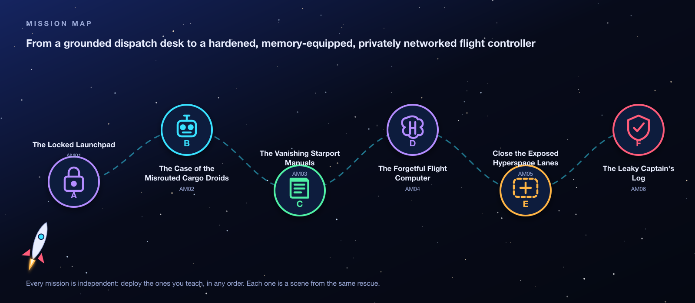

<p align="center"></p>

# OrbitOps: Cosmic Cargo Rescue

### Agentic AI break-fix labs on Amazon Bedrock AgentCore

Six hands-on **break-fix missions** that mirror the **AWS Agentic AI Demonstrated** micro-credential. In each one you're dropped into a *broken* piece of a working AI agent platform, and your job is to find the fault, prove it, fix it, and prove it's fixed. You won't find step-by-step instructions here. Instead you get a symptom, a set of clues, and a hint ladder for when you get stuck. That's how the assessment works too.

> **Broken system → symptom → investigation → evidence → hypothesis → fix → validation**

---

## 🚀 Start here

| If you are… | Go to |
|---|---|
| **In class today** | [**GETTING-STARTED.md**](GETTING-STARTED.md): sign in, find your resources, learn to read the trace panel (5 minutes). Then open your mission below. |
| **Practising on your own, after class** | [**PRACTICE-ON-YOUR-OWN.md**](PRACTICE-ON-YOUR-OWN.md): deploy any mission's broken environment into your own AWS account with Terraform. |

---

## The story

> **OrbitOps** runs a space-cargo supply chain. Operators chat with an AI **flight controller**: an orchestrator agent hosted in **AgentCore Runtime**. It finds its tools through an **AgentCore Gateway**, hands document questions to a **knowledge-base specialist**, remembers operators with **AgentCore Memory**, runs inside a **private network**, and is protected by **Bedrock Guardrails**.
>
> During an identity migration, someone broke a different piece of every subsystem. Cargo is grounded. You're on call.

<p align="center"></p>

## The missions

| | Mission | You'll work with | Time |
|:-:|---|---|:-:|
| **A** | [**AM01 · The Locked Launchpad**](AM01-cognito-oauth-launchpad/README.md)<br><sub>The chat console can't reach its AI flight controller.</sub> | Cognito OAuth 2.0 (M2M), AgentCore JWT authorizers, Lambda | 40 min |
| **B** | [**AM02 · The Case of the Misrouted Cargo Droids**](AM02-gateway-tool-routing/README.md)<br><sub>Ask where a shipment went and you get inventory counts.</sub> | AgentCore Gateway, MCP, Lambda targets, tool schemas | 40 min |
| **C** | [**AM03 · The Vanishing Starport Manuals**](AM03-knowledge-base-specialist/README.md)<br><sub>The manuals exist, but the flight controller can't answer from them.</sub> | Bedrock Knowledge Bases, S3 Vectors, AgentCore Runtime, agent-to-agent | 60 min |
| **D** | [**AM04 · The Forgetful Flight Computer**](AM04-agentcore-memory/README.md)<br><sub>Open a fresh chat and it greets you like a stranger.</sub> | AgentCore Memory, strategies, namespaces | 35 min |
| **E** | [**AM05 · Close the Exposed Hyperspace Lanes**](AM05-vpc-private-networking/README.md)<br><sub>Security wants both agents in private subnets, off the public internet.</sub> | VPC, PrivateLink interface endpoints, Runtime VPC mode | 45 min |
| **F** | [**AM06 · The Leaky Captain's Log**](AM06-bedrock-guardrails/README.md)<br><sub>It will happily reveal mission names, discount codes and personal data.</sub> | Bedrock Guardrails: denied words, PII, regex, content filters | 40 min |

The missions are independent of each other. Your instructor picks which ones to run and in what order.

## What's inside every mission

```
AM01-cognito-oauth-launchpad/
├── README.md            ← the mission handout: read this
├── assets/              ← architecture diagram, investigation map
└── student-terraform/   ← the broken environment, for practising on your own after class
```

Each handout follows the same flight plan:

| Section | What it gives you |
|---|---|
| 🚨 **Dispatch alert · Situation · Architecture** | What's broken, from the operator's point of view, with a diagram of the system. |
| 🎯 **Repair objectives** | The checklist you're graded against, phrased the way the assessment phrases it. |
| 📘 **Concept briefing** | The handful of ideas you need *before* you click anything. |
| 🗺️ **Investigation map** | For each symptom: the question to ask, and where the evidence lives. No answers. |
| 🪜 **Hint ladder** | Three levels per objective: *where to look* → *what to compare* → *the nudge*. Open one level at a time and stop as soon as you have an idea to test. |
| 🌳 **Decision tree · self-check · red herrings** | Where you are, what to check before calling for help, and what's *not* broken. |
| ✈️ **Flight Test** | How to prove the fix end to end. |

## How to get the most out of this

1. **Read the alert and the concept briefing first.** Five minutes of reading saves twenty of clicking.
2. **Collect evidence before changing anything.** Each handout has an evidence checklist. The chat console's **trace** panel is your flight recorder.
3. **Write down a hypothesis** before every change: *"Because X, I expect Y; I'll test it by Z."*
4. **Change one thing, then re-test.** Read the trace again after every change.
5. **Use the hint ladder honestly.** Level 1 → test → Level 2 → test. Opening all three at once turns a lab into a recipe.
6. **Finish with the Flight Test.** Your instructor then runs a live debrief and shares the answer guide.

## Ground rules for the shared class account

- 🌎 **Region is always `us-west-2` (US West, Oregon).** If you can't find your resources, check the region selector first.
- 🏷️ **Touch only resources with your student id**, e.g. `orbit-student07-am01-…` or `orbit_student07_am01_orchestrator`. Everyone shares one account.
- 🔑 **Keep secrets out of chat, screenshots and slides.** That includes client secrets, access keys and your chat URL (it has no login of its own).
- 💸 **Don't create anything the handout doesn't ask for.** Some services bill by the hour.

## How these labs differ from the assessment

| The assessment | These labs | Why |
|---|---|---|
| OpenSearch Serverless vector store | **Amazon S3 Vectors** (same index name) | Costs cents rather than hundreds of dollars per student. The console concepts are the same. |
| The orchestrator fetches its own Cognito token, so Mission E keeps a NAT gateway | The orchestrator **forwards your bearer token**, so Mission E closes every public path | No NAT cost, and you practise the same authorizer lessons. |
| Strands agents in containers | Plain Python agents via **direct code deployment** | No Docker builds, with the same runtime contract (`/invocations`, `/ping`). |

Every concept the assessment checks is still covered, and each handout notes these differences where they matter.

---

<sub>OrbitOps is a fictional company. AWS service names are trademarks of Amazon.com, Inc. or its affiliates.</sub>
